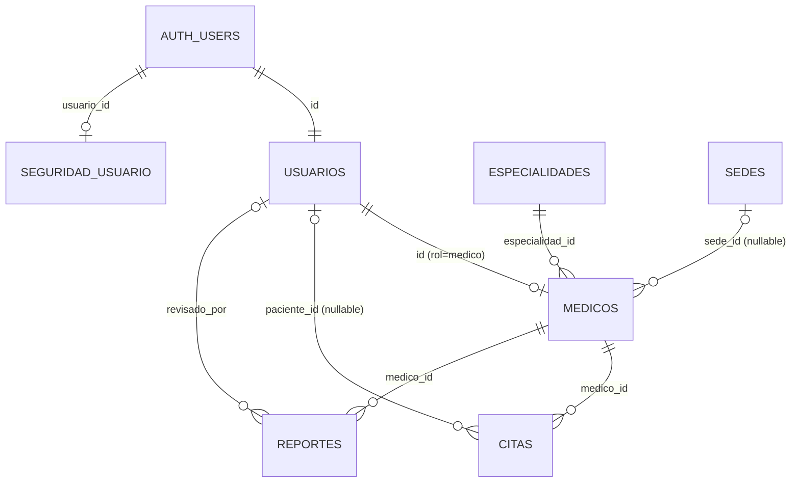
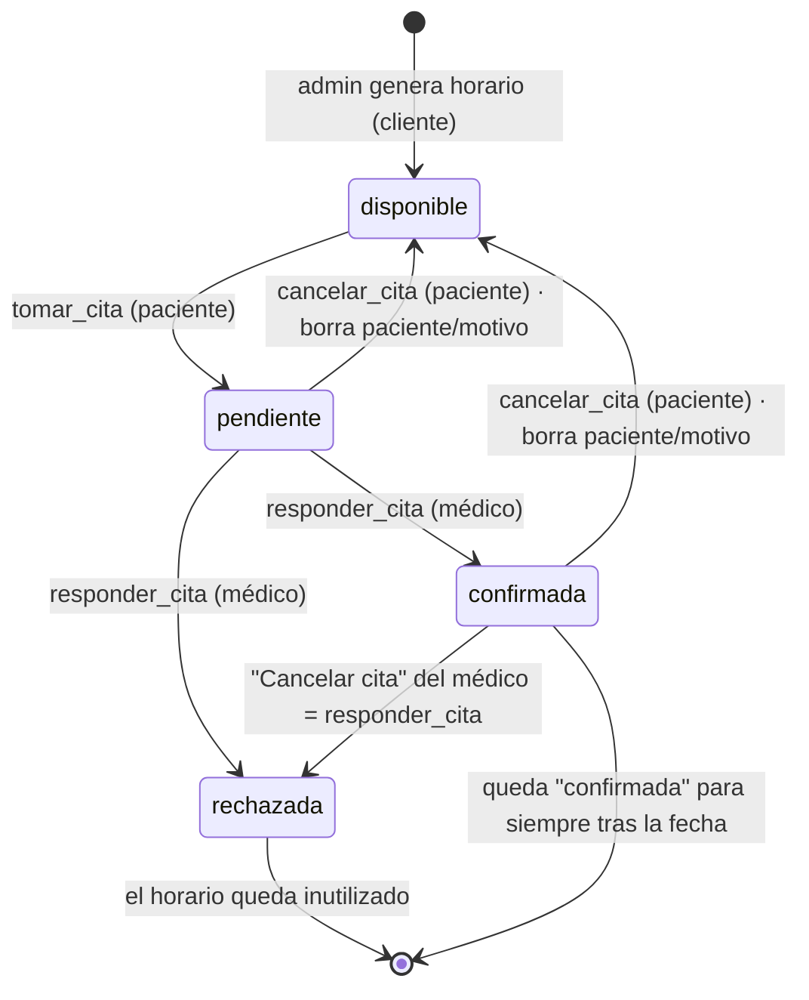

# 01 · Auditoría del proyecto SaludApp

> **Alcance.** Estado real del repositorio `saludapp-main` y de su base de datos
> Supabase (`khyfckehcvpnswdjyshv`) a fecha **23-nov-2026**. Es la línea base
> sobre la que se apoyan los documentos 02, 03 y 04.
>
> **Cómo se obtuvo la evidencia**
> - Lectura completa de los 46 archivos del repositorio (≈ 3 960 líneas de TS/TSX).
> - `npx tsc -p tsconfig.app.json --noEmit` → **0 errores**.
> - `npx oxlint` → **0 errores, 8 avisos** (detalle en §9).
> - Consultas **de solo lectura** al catálogo de Postgres (tablas, policies,
>   funciones, grants, índices, publicación Realtime, conteos) y a los
>   *advisors* de seguridad y rendimiento de Supabase. **No se modificó nada.**
> - **No** se ejecutó la app en un navegador: lo que se dice de la interfaz sale
>   del código, no de haberla probado en pantalla.
>
> **Convención.** **[H]** = hecho comprobado (con evidencia). **[I]** =
> inferencia razonada (no verificada directamente). Las propuestas están en el
> documento 03, no aquí.

---

## Índice

1. [Propósito y contexto](#1-propósito-y-contexto)
2. [Arquitectura y tecnologías](#2-arquitectura-y-tecnologías)
3. [Estructura del código](#3-estructura-del-código)
4. [Funcionalidades implementadas por rol](#4-funcionalidades-implementadas-por-rol)
5. [Modelo de datos](#5-modelo-de-datos)
6. [Seguridad: autenticación, RLS y permisos](#6-seguridad-autenticación-rls-y-permisos)
7. [Flujos y reglas de negocio](#7-flujos-y-reglas-de-negocio)
8. [Experiencia de usuario e interfaz](#8-experiencia-de-usuario-e-interfaz)
9. [Calidad, pruebas y mantenibilidad](#9-calidad-pruebas-y-mantenibilidad)
10. [Rendimiento y escalabilidad](#10-rendimiento-y-escalabilidad)
11. [Componentes reutilizables ya presentes](#11-componentes-reutilizables-ya-presentes)
12. [Fortalezas](#12-fortalezas)
13. [Registro consolidado de hallazgos](#13-registro-consolidado-de-hallazgos)
14. [Información que falta y cómo afecta](#14-información-que-falta-y-cómo-afecta)

---

## 1. Propósito y contexto

- **[H]** SaludApp es una PWA de **agendamiento de citas médicas** con tres roles:
  `paciente`, `medico` y `admin` ([README.md](../../README.md), [domain.ts](../../app/src/types/domain.ts)).
- **[H]** Nació como **ejercicio de clase**: reciclar el código de *Buses Metro*
  para otro dominio. El README la llama "versión rápida y provisional"
  ([README.md:3-4](../../README.md#L3-L4)).
- **[H]** Correspondencia de dominios declarada en el README y en los comentarios:
  pasajero → paciente, conductor → médico, agente → admin, parada → sede,
  bus → médico, reporte de retraso → novedad del médico.
- **[H]** Necesidades que resuelve hoy:
  1. El paciente encuentra especialidad/médico/sede y **solicita** un horario libre.
  2. El médico **acepta o rechaza** las solicitudes en vivo.
  3. El médico **reporta novedades** (retraso, ausencia) que el admin aprueba
     antes de que el paciente vea una alerta.
  4. El admin **asigna sedes** a médicos y **abre horarios**.
- **[H]** Datos de demostración en la base: 12 usuarios (1 admin, 7 médicos,
  4 pacientes), 4 sedes, 4 especialidades, 721 citas (712 disponibles,
  6 confirmadas, 1 pendiente, 2 rechazadas) y 3 reportes (todos aprobados).

## 2. Arquitectura y tecnologías

```
Navegador (React 19 SPA, anon key)
  App.tsx ── AuthProvider ── RutaProtegida(rol) ── PacientePage | MedicoPage | AdminPage
      │                                │
      │ supabase-js (REST + RPC + Realtime)        functions.invoke('recuperar-password')
      ▼                                ▼
Supabase: Auth · Postgres (RLS) · PostgREST · Realtime(citas, reportes) · Edge Function (Deno)
```

| Pieza | Versión ([package.json](../../app/package.json)) | Uso real |
|---|---|---|
| React / React DOM | ^19.2.8 | UI |
| React Router DOM | ^7.18.3 | 5 rutas, una protegida por rol ([App.tsx](../../app/src/App.tsx)) |
| Vite + plugin React | ^8.2.2 / ^6.1.0 | Build y dev server |
| TypeScript | ~6.0.2 | Todo el código |
| Tailwind CSS 4 | ^4.3.3 | Estilos con valores arbitrarios (`bg-[#013b4d]`) |
| @supabase/supabase-js | ^2.112.4 | Cliente **sin tipar** (`createClient(url, key)`) |
| @vis.gl/react-google-maps | ^1.10.1 | Mapa de sedes del paciente |
| lucide-react | ^1.39.0 | Iconos |
| oxlint | ^1.79.0 | Lint |
| concurrently / cross-env | — | `npm run dev:all` (un puerto por rol) |
| motion, @radix-ui/react-dialog, -tooltip, -dropdown-menu | — | **Instaladas pero sin uso** (búsqueda en `src/` sin resultados) **[H]** |

- **[H]** No hay backend propio: toda la lógica de servidor vive en Postgres
  (policies + funciones `SECURITY DEFINER`) y en una Edge Function.
- **[H]** No hay Vitest, ni script `test`, ni tipos generados de la base.
- **[H]** No hay configuración de hosting (`vercel.json`, `_redirects`) ni service worker.
- **[H]** La carpeta **no es un repositorio git** (no hay historial que consultar).

## 3. Estructura del código

```
app/src
├── App.tsx, main.tsx, index.css
├── types/domain.ts            tipos escritos a mano (no derivados de la base)
├── lib/
│   ├── supabaseClient.ts      cliente sin genérico Database
│   ├── AuthContext.tsx        sesión + rol + nombre (contexto y hook en el mismo archivo)
│   ├── RutaProtegida.tsx, rolInicial.ts
│   ├── Plantilla.tsx          Encabezado, Portada, Plantas, TituloSeccion, TarjetaMetrica, Pie
│   ├── Marca.tsx              logo SVG
│   ├── citas.ts               formato de fechas en America/Bogota, estados de cita, iconos
│   ├── Mapa.tsx (481 líneas)  componentes de Google Maps (varios del dominio buses, sin uso)
│   ├── mapaConfig.ts, paradaCercana.ts
│   ├── CampoPassword.tsx, validarPassword.ts, validarEmail.ts, preguntasSeguridad.ts
├── hooks/useAlertaNovedades.ts, useMiUbicacion.ts
└── pages/
    ├── login/ SeleccionRolPage (38), LoginPage (324), RecuperarPasswordPage (225)
    ├── paciente/PacientePage.tsx (868)
    ├── medico/MedicoPage.tsx (483)
    └── admin/AdminPage.tsx (568)
supabase/
├── README.md                  describe la base, pero no contiene el esquema
└── functions/recuperar-password/index.ts
```

Observaciones **[H]**:
- Las tres páginas concentran estado, carga de datos, Realtime y presentación
  en un único archivo cada una (868 / 568 / 483 líneas).
- Hay duplicación menor: `tiempoRelativo` definido dentro de
  [AdminPage.tsx:45-54](../../app/src/pages/admin/AdminPage.tsx#L45-L54); `Tarjeta`
  ([AdminPage.tsx:56-83](../../app/src/pages/admin/AdminPage.tsx#L56-L83)) convive con
  `TarjetaMetrica` ([Plantilla.tsx:110-142](../../app/src/lib/Plantilla.tsx#L110-L142));
  el cálculo de "inicio de hoy" con `-05:00` fijo aparece en
  [MedicoPage.tsx:83](../../app/src/pages/medico/MedicoPage.tsx#L83) y
  [AdminPage.tsx:246](../../app/src/pages/admin/AdminPage.tsx#L246).
- `Mapa.tsx` exporta `MarcadorBus`, `RutaDibujada`, `RutaConSentidos`,
  `SeguirPunto`, `CentrarEn` y `MarcadorParadaRotulada`, que **no se usan**;
  `mapaConfig.ts` exporta `COLORES_RUTA`, `COLOR_IDA`, `COLOR_VUELTA` y
  `longitudKm`, tampoco usados. El paciente solo usa `Mapa`, `AjustarARuta`,
  `MarcadorParada` y `MarcadorMiUbicacion` ([PacientePage.tsx:20](../../app/src/pages/paciente/PacientePage.tsx#L20)).

## 4. Funcionalidades implementadas por rol

Estado: ✅ funciona según el código · ⚠️ existe con limitaciones · ❌ no existe / no funciona.

### Comunes

| Funcionalidad | Estado | Evidencia |
|---|---|---|
| Selección de rol y login por rol | ✅ | [SeleccionRolPage.tsx](../../app/src/pages/login/SeleccionRolPage.tsx), [LoginPage.tsx](../../app/src/pages/login/LoginPage.tsx) |
| Registro (solo paciente) con contraseña robusta y pregunta de seguridad | ⚠️ | Falla si Auth exige confirmar el correo (ver H-U2) — [LoginPage.tsx:128-133](../../app/src/pages/login/LoginPage.tsx#L128-L133) |
| Recuperación de contraseña por pregunta de seguridad | ⚠️ | Funciona también para admin y médicos (ver H-S2) |
| Un puerto por rol en desarrollo | ✅ | `dev:all` en [package.json:11](../../app/package.json#L11) |
| Botón "Configuración" (tuerca) | ❌ | Botón sin `onClick` — [Plantilla.tsx:25-32](../../app/src/lib/Plantilla.tsx#L25-L32) |
| Cambiar nombre / contraseña estando dentro | ❌ | No hay pantalla; además `authenticated` no tiene `UPDATE` sobre `usuarios` |
| Cerrar sesión | ✅ | [Plantilla.tsx:44-50](../../app/src/lib/Plantilla.tsx#L44-L50) |

### Paciente ([PacientePage.tsx](../../app/src/pages/paciente/PacientePage.tsx))

| Funcionalidad | Estado | Evidencia |
|---|---|---|
| Búsqueda por especialidad, médico, sede o ciudad | ✅ | líneas 165-178 |
| "Tu próxima cita" | ✅ | líneas 159-162, 215-254 |
| Mapa de sedes + "Tu clínica más cercana" | ✅ | líneas 101-138, 292-338 |
| Agendar: filtros ciudad/sede, calendario de 14 días, horarios por médico, motivo | ✅ | líneas 356-610; RPC `tomar_cita` línea 430 |
| Mis citas con KPIs y filtros | ✅ | líneas 617-750 |
| Cancelar cita | ⚠️ | Borra la cita del historial del paciente (ver H-R2) — línea 644 |
| "Reagendar" | ⚠️ | Solo abre el agendador; **no cancela ni mueve** la cita anterior — líneas 732-739, 841 |
| Cambios de estado en vivo | ✅ | Realtime filtrado por `paciente_id` — líneas 793-806 |
| Alerta 🚨 de novedad aprobada | ⚠️ | Poco precisa (ver H-R6) — [useAlertaNovedades.ts](../../app/src/hooks/useAlertaNovedades.ts) |
| Navegación con "atrás" del navegador / enlaces directos | ❌ | La vista es estado local (`useState<Vista>`) — líneas 37, 755 |

### Médico ([MedicoPage.tsx](../../app/src/pages/medico/MedicoPage.tsx))

| Funcionalidad | Estado | Evidencia |
|---|---|---|
| KPIs: citas hoy, pendientes, confirmadas, horarios libres | ✅ | líneas 128-135, 218-223 |
| Lista de próximas citas con pendientes primero | ✅ | líneas 137-151 |
| Aceptar / rechazar con mensaje al paciente | ✅ | RPC `responder_cita` — líneas 154-169 |
| "Cancelar cita" confirmada | ⚠️ | Se implementa como **rechazo**: el horario no se libera (ver H-R1) — líneas 334-341 |
| Reportar novedad (10 min, 15 min, no disponible, texto libre) | ✅ | líneas 29-33, 183-201 |
| Ver estado de sus últimas 5 novedades | ⚠️ | No ve el motivo de un rechazo (la tabla no tiene esa columna) — líneas 88-93, 463-475 |
| Marcar cita como atendida / no asistió | ❌ | No existe el estado |
| Agenda por días / semanas | ❌ | Solo lista desde hoy |

### Administrador ([AdminPage.tsx](../../app/src/pages/admin/AdminPage.tsx))

| Funcionalidad | Estado | Evidencia |
|---|---|---|
| KPIs: novedades por revisar, citas hoy, por confirmar, médicos/sedes | ⚠️ | Calculados sobre una lista recortada a 50 — líneas 33, 261-272 |
| Bandeja de novedades con filtros por estado y barra de distribución | ✅ | líneas 448-558 |
| Aprobar / rechazar novedad | ⚠️ | Ignora errores y no detecta rechazos silenciosos de RLS; sin motivo de rechazo — líneas 189-199 |
| Archivar resueltas + ver histórico | ✅ | RPC `archivar_reportes_resueltos` — líneas 201-215 |
| Tabla de citas tomadas | ⚠️ | Sin filtros ni paginación; carga todas — líneas 147, 337-377 |
| Asignar sede a médico | ✅ | Detecta rechazo silencioso con `.select()` — líneas 224-231 |
| Generar horarios (14 días, L-S, horas fijas) | ⚠️ | Lógica en el cliente, horas iguales para todos, sin restricción de unicidad — líneas 37, 234-259 |
| Crear médicos, sedes o especialidades | ❌ | Solo posible por SQL / dashboard |
| Estadísticas o reportes históricos | ❌ | — |

## 5. Modelo de datos

**[H]** Leído del catálogo de la base (no existe `schema.sql` en el repo).
Una sola migración remota: `20261028165857 saludapp_esquema`.



| Tabla | Columnas clave | Restricciones / notas |
|---|---|---|
| `usuarios` | id, nombre, rol | `check rol in (paciente, medico, admin)`; **sin** check de nombre; FK a `auth.users` (no se verificó el `on delete`) |
| `sedes` | nombre, ciudad, direccion, lat, lng | — |
| `especialidades` | nombre (único), descripcion, icono | — |
| `medicos` | id (=usuario), especialidad_id, sede_id, consultorio | FK sin índice en `especialidad_id`, `sede_id` (advisor) |
| `citas` | medico_id, inicio, paciente_id, estado, motivo, mensaje, actualizado_en | `check estado in (disponible, pendiente, confirmada, rechazada, cancelada)`; índice **no único** `(medico_id, inicio)`; índice `(paciente_id)` |
| `reportes` | medico_id, motivo, estado, revisado_por, revisado_en, archivado, creado_en | índice `(archivado, creado_en desc)`; FKs sin índice (advisor) |
| `seguridad_usuario` | usuario_id, pregunta, respuesta_hash (bcrypt), intentos_fallidos, bloqueado_hasta | RLS activo **sin policies** (tabla secreta, correcto) |

Modelo de "cita" **[H]**: cada horario es una fila; `disponible` sin paciente →
`tomar_cita` la pasa a `pendiente` con el paciente → `responder_cita` la pasa a
`confirmada` o `rechazada`. `cancelar_cita` la **devuelve a `disponible`**
borrando paciente, motivo y mensaje. El estado `cancelada` existe en el `check`
y en [citas.ts:49](../../app/src/lib/citas.ts#L49), pero **ninguna función lo asigna**.

Realtime **[H]**: publicación `supabase_realtime` contiene `citas` y `reportes`.

## 6. Seguridad: autenticación, RLS y permisos

### 6.1 Autenticación

- **[H]** `AuthProvider` lee la sesión, se suscribe a `onAuthStateChange` y
  consulta `usuarios.rol, nombre` dependiendo del **id** de usuario (no del
  objeto sesión) — buena práctica heredada ([AuthContext.tsx:38-66](../../app/src/lib/AuthContext.tsx#L38-L66)).
- **[H]** Usa `.single()` e **ignora el error**: un fallo de red se trata igual
  que "no tiene rol" y `RutaProtegida` manda al login ([AuthContext.tsx:52-62](../../app/src/lib/AuthContext.tsx#L52-L62)).
- **[H]** El perfil lo inserta **el cliente** tras `signUp`
  ([LoginPage.tsx:149-151](../../app/src/pages/login/LoginPage.tsx#L149-L151)),
  permitido por la policy `usuarios_insert_paciente`. **No hay trigger** de perfil
  en `auth.users` (la consulta de triggers no devolvió ninguno).
- **[H]** Requisitos de contraseña: solo en el cliente
  ([validarPassword.ts](../../app/src/lib/validarPassword.ts)) y en la Edge Function.
  El advisor indica **"Leaked password protection" desactivado**. La configuración
  de Auth (mínimo de caracteres, confirmación de correo) **no se pudo verificar**.

### 6.2 Policies RLS (leídas de `pg_policies`)

| Tabla | Policy | Regla | Evaluación |
|---|---|---|---|
| usuarios | `usuarios_select` | authenticated, `true` | ⚠️ Cualquier usuario autenticado lista **todos** los usuarios con nombre y rol |
| usuarios | `usuarios_insert_paciente` | `id = auth.uid() and rol = 'paciente'` | ✅ impide autoasignarse otro rol; `auth.uid()` sin `select` (advisor 0003) |
| sedes / especialidades / medicos | `*_select` | anon+authenticated, `true` | ✅ catálogo público |
| medicos | `medicos_update_admin` | `es_admin()` | ✅ |
| citas | `citas_select` | `estado='disponible' or paciente_id=uid or medico_id=uid or es_admin()` | ✅ bien acotada; `auth.uid()` sin `select` (advisor) |
| citas | `citas_insert_admin` | `es_admin()` | ✅; no hay update/delete directos (todo por funciones) |
| reportes | `reportes_select` | authenticated, `true` | ⚠️ pacientes leen **todas** las novedades (incluso pendientes y rechazadas) y reciben sus eventos Realtime |
| reportes | `reportes_insert_medico` | `medico_id = (select auth.uid())` | ❌ **no fuerza** `estado='pendiente'` ni `revisado_*` nulos |
| reportes | `reportes_update_admin` | `es_admin()` | ✅ (sin límite de columnas) |

### 6.3 Funciones de la base

| Función | Tipo | Valida | Ejecutable por |
|---|---|---|---|
| `tomar_cita(p_cita, p_motivo)` | definer | rol paciente; `estado='disponible' and inicio > now()` en el mismo `UPDATE` (sin carreras) | PUBLIC (incluye **anon**) |
| `cancelar_cita(p_cita)` | definer | `paciente_id = auth.uid()` y estado pendiente/confirmada | PUBLIC |
| `responder_cita(p_cita, p_estado, p_mensaje)` | definer | `medico_id = auth.uid()`; estado de origen pendiente/confirmada | PUBLIC |
| `archivar_reportes_resueltos(p_dias)` | definer | `es_admin()` | PUBLIC |
| `guardar_pregunta_seguridad(p, r)` | definer | `auth.uid()` no nulo, longitudes | PUBLIC |
| `es_admin()` | definer, stable | — | PUBLIC |
| `recuperacion_obtener_pregunta`, `recuperacion_verificar` | definer | bloqueo 5 fallos/15 min | solo `service_role` ✅ |

**[H]** El advisor de Supabase marca 6 funciones `SECURITY DEFINER` ejecutables por
`anon` (lint 0028). **[I]** No se encontró una vía de explotación porque cada una
valida `auth.uid()`/rol internamente, pero contradice la convención de
"revocar por rol" de la guía (§5.3).

### 6.4 Edge Function `recuperar-password`

- **[H]** Desplegada (v1, `verify_jwt=false`), idéntica a la del repo
  ([index.ts](../../supabase/functions/recuperar-password/index.ts)). Repite la
  validación de contraseña en el servidor (correcto).
- **[H]** Ni la función ni `recuperacion_*` filtran por rol. **[H]** Los 12
  usuarios (incluido el admin) tienen pregunta de seguridad, y el README publica
  la respuesta: «¿En qué ciudad naciste?» → `medellin`
  ([README.md:26-27](../../README.md#L26-L27)).

## 7. Flujos y reglas de negocio

### 7.1 Ciclo de vida actual de una cita



### 7.2 Ciclo de una novedad

`medico` inserta `reportes(pendiente)` → `admin` actualiza a `aprobado`/`rechazado`
→ los pacientes con cita activa con ese médico ven la alerta (si el `UPDATE` les
llega por Realtime o si fue aprobada en las últimas 6 h) → `admin` archiva
resueltas con más de 1 día.

### 7.3 Reglas que existen **[H]**
- Solo pacientes toman citas; solo horarios futuros y disponibles; la toma es atómica.
- El médico solo responde sus citas; el paciente solo cancela las suyas.
- Solo el admin crea horarios, asigna sedes, aprueba novedades y archiva.
- Fechas mostradas siempre en `America/Bogota` ([citas.ts:7](../../app/src/lib/citas.ts#L7)).

### 7.4 Reglas que faltan **[H]** (no existen en código ni en la base)
- Límite de citas activas por paciente, o impedir dos citas a la misma hora.
- Plazo mínimo para cancelar; motivo de cancelación.
- Plazo para responder una solicitud; qué pasa con pendientes que llegan a su hora.
- Cierre de la cita (atendida / no asistió).
- Unicidad de horario por médico (`(medico_id, inicio)` no es único).
- Alcance temporal de una novedad (a qué día o citas afecta).

## 8. Experiencia de usuario e interfaz

**Positivo [H]:** diseño coherente compartido en `Plantilla.tsx`; los estados
llevan icono + texto, no solo color ([citas.ts:42-50](../../app/src/lib/citas.ts#L42-L50));
`aria-label` en botones de icono; aviso honesto "Mapa no configurado"; calendario
que desactiva días sin cupo y salta al primero con cupo.

**Problemas [H]:**
- Errores mostrados con `error.message` crudo (en inglés, técnico):
  [LoginPage.tsx:87](../../app/src/pages/login/LoginPage.tsx#L87), [:116](../../app/src/pages/login/LoginPage.tsx#L116),
  [PacientePage.tsx:433](../../app/src/pages/paciente/PacientePage.tsx#L433),
  [MedicoPage.tsx:164](../../app/src/pages/medico/MedicoPage.tsx#L164), [:195](../../app/src/pages/medico/MedicoPage.tsx#L195).
- Cargas que descartan el error y muestran estados vacíos engañosos ("No hay
  médicos con esos filtros", "No tienes citas"):
  [PacientePage.tsx:396-405](../../app/src/pages/paciente/PacientePage.tsx#L396-L405),
  [:764-785](../../app/src/pages/paciente/PacientePage.tsx#L764-L785),
  [MedicoPage.tsx:84-104](../../app/src/pages/medico/MedicoPage.tsx#L84-L104),
  [AdminPage.tsx:135-170](../../app/src/pages/admin/AdminPage.tsx#L135-L170).
- Si el login tiene éxito pero no hay perfil, `enviando` nunca vuelve a `false`
  y el botón queda en "Un momento…" ([LoginPage.tsx:85-90](../../app/src/pages/login/LoginPage.tsx#L85-L90)).
- Acciones destructivas sin confirmación (cancelar cita, rechazar).
- La alerta 🚨 no tiene `role="alert"` ([PacientePage.tsx:79-96](../../app/src/pages/paciente/PacientePage.tsx#L79-L96)).
- "Ver detalles" de la próxima cita lleva a la lista general, no al detalle.
- Mapa centrado a mano en Medellín si no hay ubicación ([PacientePage.tsx:182](../../app/src/pages/paciente/PacientePage.tsx#L182)).

## 9. Calidad, pruebas y mantenibilidad

| Aspecto | Estado |
|---|---|
| Compilación TypeScript | **[H]** 0 errores |
| Lint (oxlint) | **[H]** 0 errores, 8 avisos: `only-export-components` y `set-state-in-effect` en AuthContext; `purity` (`Date.now` en render) en MedicoPage:140 y PacientePage:633; `set-state-in-effect` en MedicoPage:108, AdminPage:174, PacientePage:789; `static-components` en PacientePage:64 |
| Pruebas automatizadas | **[H]** ninguna (ni unitarias, ni de componentes, ni de permisos SQL) |
| Tipos de la base | **[H]** escritos a mano; consultas con `as Cita[]` |
| Esquema versionado | **[H]** no: solo existe en la base remota |
| Dependencias sin uso | **[H]** `motion`, 3 paquetes `@radix-ui` |
| Código muerto | **[H]** 6 componentes y 4 exportaciones de mapas del dominio buses |
| Activos pesados | **[H]** `planta-izquierda.png` 1,2 MB, `planta-derecha.png` 445 KB |
| Zona horaria | **[H]** `-05:00` escrito a mano en 2 lugares. **[I]** Correcto hoy (Colombia no tiene horario de verano), pero se rompe si el producto sale del país |

## 10. Rendimiento y escalabilidad

- **[H]** Volumen actual pequeño (721 citas): no hay problemas visibles.
- **[H]** Advisors de rendimiento: 4 FK sin índice (`medicos.especialidad_id`,
  `medicos.sede_id`, `reportes.medico_id`, `reportes.revisado_por`) y 2 policies
  que reevalúan `auth.uid()` por fila (`usuarios_insert_paciente`, `citas_select`).
- **[I]** Patrón "ante cualquier evento, recargar todo": el admin recarga
  **6 consultas** por cada `UPDATE` de cualquier cita
  ([AdminPage.tsx:178-187](../../app/src/pages/admin/AdminPage.tsx#L178-L187)); el
  médico recarga 4-6 consultas, incluida la **lista de todos los pacientes**
  ([MedicoPage.tsx:87](../../app/src/pages/medico/MedicoPage.tsx#L87)), por cada
  cambio en sus citas. Escala mal con cientos de usuarios simultáneos.
- **[I]** La pestaña de citas del admin carga todas las citas no disponibles sin
  límite ([AdminPage.tsx:147](../../app/src/pages/admin/AdminPage.tsx#L147)): crecerá sin cota.
- **[H]** Todos los pacientes conectados reciben cada `UPDATE` de `reportes` y
  filtran en el cliente ([useAlertaNovedades.ts:33-46](../../app/src/hooks/useAlertaNovedades.ts#L33-L46)).

## 11. Componentes reutilizables ya presentes

| Pieza | Reutilizable para |
|---|---|
| `Plantilla.tsx` (Encabezado con slot `derecha`, Portada, TituloSeccion, TarjetaMetrica, Pie) | cualquier pantalla nueva |
| `citas.ts` (`fechaLarga`, `hora`, `claveDia`, `diaCorto`, `proximosDias`, `ESTADOS_CITA`) | agenda, estadísticas, notificaciones |
| `Mapa.tsx` (`Mapa`, `AjustarARuta`, `MarcadorParada`, `MarcadorMiUbicacion`) + `paradaCercana.ts` | "cómo llegar", orden por cercanía, alta de sedes |
| `useMiUbicacion` | cercanía |
| `CampoPassword`, `RequisitosPassword`, `validarPassword`, `validarEmail` | ajustes de cuenta, alta de médicos |
| `llamarRecuperacion` (desenvuelve errores de Edge Functions) | cualquier Edge Function nueva |
| Funciones SQL `tomar_cita`/`responder_cita` | plantilla de transiciones de estado seguras |

## 12. Fortalezas

1. **[H]** Las transiciones de estado de las citas pasan por funciones de la base
   que validan rol y propiedad; no hay `UPDATE` directo sobre `citas`.
2. **[H]** `tomar_cita` es atómica (`UPDATE … where estado='disponible'`): dos
   pacientes no pueden tomar el mismo horario.
3. **[H]** RLS activo en todas las tablas; `seguridad_usuario` sin policies.
4. **[H]** Recuperación de contraseña con hash bcrypt, normalización `unaccent`,
   bloqueo tras 5 fallos y validación de contraseña en el servidor.
5. **[H]** Realtime ya funciona en los tres roles.
6. **[H]** Interfaz cuidada y accesible en lo básico; código limpio para tsc y sin errores de lint.
7. **[H]** Comentarios que explican el *por qué* (herencia de Buses Metro).

## 13. Registro consolidado de hallazgos

Severidad: **Crítica** (riesgo grave e inmediato) · **Alta** · **Media** · **Baja**.

### Seguridad

| ID | Sev. | Hallazgo | Evidencia |
|---|---|---|---|
| H-S1 | **Alta** | Un médico puede saltarse la aprobación del admin: la policy de insert no fuerza `estado='pendiente'`, así que puede crear por API una novedad `aprobado` con `revisado_en` reciente. La carga inicial de la alerta la mostraría a sus pacientes. **[H]** policy; **[I]** vía de explotación (no se ejecutó para no escribir en la base) | `pg_policies.reportes_insert_medico`; [useAlertaNovedades.ts:51-60](../../app/src/hooks/useAlertaNovedades.ts#L51-L60) |
| H-S2 | **Alta** (Crítica si sale de la demo) | Cualquiera puede apoderarse de la cuenta **admin**: la recuperación no filtra por rol, el admin tiene pregunta configurada y la respuesta está en el README. Las contraseñas de prueba (`123456`) tampoco cumplen los requisitos actuales | [README.md:26-27](../../README.md#L26-L27); consulta: admin 1/1 con pregunta; [index.ts](../../supabase/functions/recuperar-password/index.ts) |
| H-S3 | Media | Exposición de datos personales: cualquier autenticado lista todos los usuarios; el médico descarga los nombres de **todos** los pacientes; los pacientes leen todas las novedades | `usuarios_select`, `reportes_select`; [MedicoPage.tsx:87](../../app/src/pages/medico/MedicoPage.tsx#L87) |
| H-S4 | Media | 6 funciones `SECURITY DEFINER` ejecutables por `anon` | Advisor 0028; ACL `=X/postgres` |
| H-S5 | Baja | Protección de contraseñas filtradas desactivada; requisitos no exigidos por Auth (no verificable) | Advisor `auth_leaked_password_protection` |
| H-S6 | Baja | `reportes_update_admin` no limita columnas (el admin podría reescribir `motivo` o `medico_id`) | `pg_policies` |

### Reglas de negocio e integridad

| ID | Sev. | Hallazgo | Evidencia |
|---|---|---|---|
| H-R1 | **Alta** | Rechazar (o "cancelar" desde el médico) **inutiliza el horario**: la fila queda `rechazada` y ninguna función ni el generador la reabre | `responder_cita`; [MedicoPage.tsx:334-341](../../app/src/pages/medico/MedicoPage.tsx#L334-L341); [AdminPage.tsx:238-247](../../app/src/pages/admin/AdminPage.tsx#L238-L247) |
| H-R2 | Media | La cancelación del paciente borra la cita de su historial; el estado `cancelada` nunca se usa; no se pueden medir cancelaciones | `cancelar_cita` |
| H-R3 | Media | Sin límites de reserva: un paciente puede acaparar horarios o tomar dos citas a la misma hora | `tomar_cita` |
| H-R4 | Media | "Reagendar" no reagenda | [PacientePage.tsx:732-739](../../app/src/pages/paciente/PacientePage.tsx#L732-L739) |
| H-R5 | Media | Generación de horarios en el cliente, con horas fijas iguales para todos y sin índice único → posible duplicado con doble clic o dos admins (hoy 0 duplicados) | [AdminPage.tsx:36-38, 234-259](../../app/src/pages/admin/AdminPage.tsx#L234-L259); índice no único |
| H-R6 | Media | La alerta de novedad llega a pacientes cuya cita es otro día; ventana fija de 6 h; motivo en texto libre sin minutos estructurados; una sola alerta a la vez | [useAlertaNovedades.ts](../../app/src/hooks/useAlertaNovedades.ts) |
| H-R7 | Baja | Citas pasadas quedan `confirmada`/`pendiente` para siempre; no hay cierre | `check` de `citas.estado` |

### Robustez y UX

| ID | Sev. | Hallazgo | Evidencia |
|---|---|---|---|
| H-U1 | **Alta** | Un fallo de red al leer el perfil expulsa al login; un usuario sin perfil queda atascado en "Un momento…" | [AuthContext.tsx:52-62](../../app/src/lib/AuthContext.tsx#L52-L62); [LoginPage.tsx:85-90](../../app/src/pages/login/LoginPage.tsx#L85-L90) |
| H-U2 | **Alta** (si Auth confirma correo) | Con confirmación de correo activa, el registro termina antes de guardar la pregunta y el perfil → cuenta sin perfil. **[I]** Hoy hay 0 cuentas sin perfil, así que la confirmación probablemente está desactivada | [LoginPage.tsx:128-133](../../app/src/pages/login/LoginPage.tsx#L128-L133) |
| H-U3 | Media | Errores de carga silenciados → estados vacíos engañosos; aprobar/rechazar novedad ignora errores | §8 |
| H-U4 | Media | Mensajes de error crudos en inglés | §8 |
| H-U5 | Media | Botón de configuración decorativo | [Plantilla.tsx:25-32](../../app/src/lib/Plantilla.tsx#L25-L32) |
| H-U6 | Media | Navegación del paciente sin URL (el "atrás" del móvil sale de la app) | [PacientePage.tsx:755](../../app/src/pages/paciente/PacientePage.tsx#L755) |
| H-U7 | Baja | KPIs del admin sobre lista recortada a 50, sin aviso "mostrando 50 de N" | [AdminPage.tsx:261-268](../../app/src/pages/admin/AdminPage.tsx#L261-L268) |
| H-U8 | Baja | "Próxima cita" y filtros por fecha usan `Date.now()` en render: no se actualizan con la página abierta | avisos `purity` |

### Mantenibilidad

| ID | Sev. | Hallazgo | Evidencia |
|---|---|---|---|
| H-M1 | **Alta** | Esquema, policies y funciones no versionados: la base no se puede reconstruir desde el repo | [supabase/README.md](../../supabase/README.md) |
| H-M2 | Media | Sin pruebas automatizadas | [package.json](../../app/package.json) |
| H-M3 | Media | Cliente sin tipos generados | [supabaseClient.ts:12](../../app/src/lib/supabaseClient.ts#L12) |
| H-M4 | Baja | Páginas monolíticas y pequeñas duplicaciones | §3 |
| H-M5 | Baja | Dependencias y código de mapas sin uso; imágenes pesadas | §9 |

## 14. Información que falta y cómo afecta

| Falta | Impacto en las conclusiones |
|---|---|
| **Código fuente de Buses Metro** (solo se dispone de la guía en PDF) | La reutilización de nivel A supone tener acceso a ese repositorio. Sin él, cada módulo se reescribe a partir de la descripción de la guía (+20-40 % de esfuerzo; ver doc 03) |
| Configuración de Supabase Auth (confirmación de correo, política de contraseñas, URLs) | No se puede confirmar H-U2 ni H-S5; se infirió por la ausencia de cuentas sin perfil |
| Destino del producto: ¿demo de clase o despliegue con pacientes reales? | Determina si H-S2/H-S3 son "Alta" o "Crítica", y si hay obligaciones legales sobre datos de salud (p. ej. habeas data en Colombia), que requieren revisión jurídica fuera de este análisis |
| Plazo, tamaño del equipo y dedicación semanal | Afecta qué plan del doc 04 es realista |
| Hosting previsto | Sin él no se puede valorar el *rewrite* SPA ni las restricciones de la clave de Maps |
| Si la restricción por referente de la clave de Google Maps está realmente configurada | Solo consta en un comentario de [.env.example](../../app/.env.example) |
| Comportamiento real en navegador | No se ejecutó la app; los hallazgos de UI salen del código |
