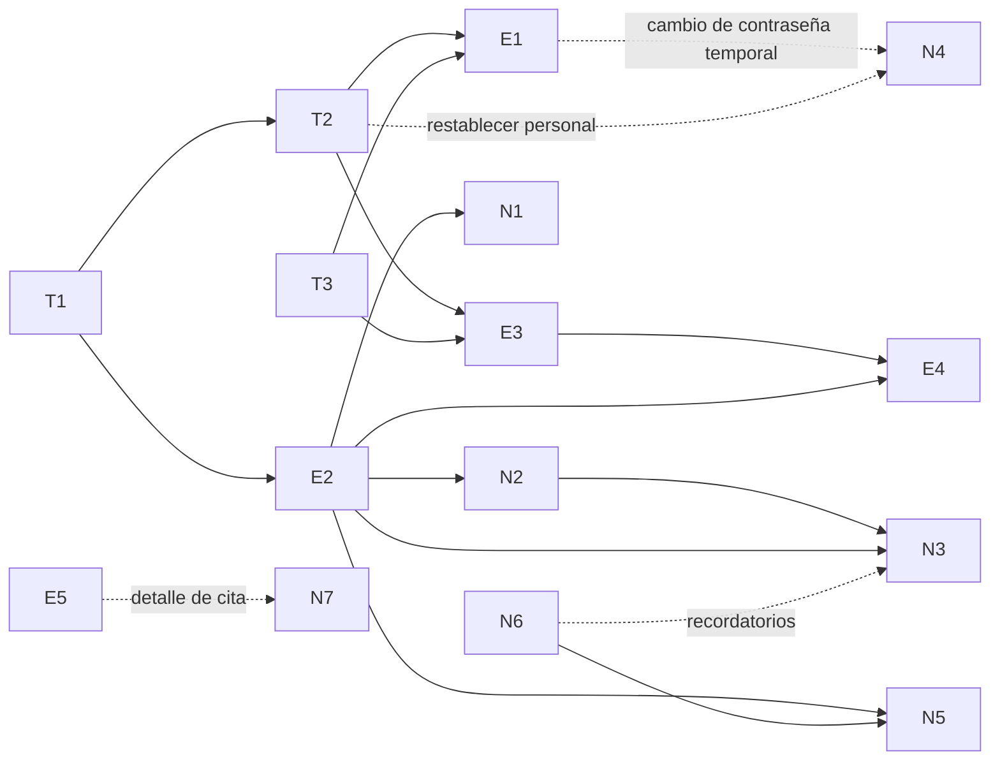

# 03 · Propuestas de funcionalidades para SaludApp

> Basado en la auditoría ([01](01-auditoria-proyecto.md)) y el análisis de la
> guía ([02](02-analisis-reutilizacion.md)). **Nada de esto está implementado**:
> son propuestas pendientes de autorización.
>
> **Tipos de propuesta**
> - **T · Mejora técnica**: no añade funciones visibles; corrige o habilita.
> - **E · Ampliación**: mejora una funcionalidad que ya existe.
> - **N · Nueva funcionalidad**.
>
> **Supuestos de las estimaciones de esfuerzo**
> 1. Una persona con soltura en React + Supabase, que ya conoce este repositorio.
> 2. **Con acceso al código de Buses Metro** para los módulos A/B. Sin acceso,
>    sumar **+20-40 %** a las propuestas marcadas A/B (hay que reescribirlos a
>    partir de la guía).
> 3. Incluye: migración SQL, código, prueba manual con los tres roles,
>    actualización de `permisos.sql` y de la documentación. No incluye diseño
>    gráfico nuevo ni despliegue a producción.
> 4. Los rangos ya incluyen un margen por imprevistos; en el doc 04 no se añade otro.
>
> Escala: **Complejidad** baja · media · alta · muy alta.
> **Impacto** bajo · medio · alto · muy alto.

---

## Índice

| ID | Propuesta | Tipo |
|---|---|---|
| [T1](#t1--versionar-el-esquema-de-la-base-de-datos) | Versionar el esquema de la base de datos | Técnica |
| [T2](#t2--endurecimiento-de-seguridad-rls-permisos-y-recuperación) | Endurecimiento de seguridad (RLS, permisos y recuperación) | Técnica |
| [T3](#t3--sesión-y-manejo-de-errores-robustos) | Sesión y manejo de errores robustos | Técnica |
| [T4](#t4--pruebas-automatizadas-y-tipos-generados) | Pruebas automatizadas y tipos generados | Técnica |
| [T5](#t5--limpieza-de-dependencias-código-muerto-y-activos) | Limpieza de dependencias, código muerto y activos | Técnica |
| [E1](#e1--ajustes-de-cuenta) | Ajustes de cuenta (la tuerca funcional) | Ampliación |
| [E2](#e2--ciclo-de-vida-completo-de-la-cita) | Ciclo de vida completo de la cita | Ampliación |
| [E3](#e3--bandeja-de-novedades-20) | Bandeja de novedades 2.0 | Ampliación |
| [E4](#e4--alertas-dirigidas-con-hora-estimada-de-atención) | Alertas dirigidas con hora estimada de atención | Ampliación |
| [E5](#e5--navegación-del-paciente-por-url) | Navegación del paciente por URL | Ampliación |
| [N1](#n1--panel-de-estadísticas-del-administrador) | Panel de estadísticas del administrador | Nueva |
| [N2](#n2--disponibilidad-configurable-por-médico) | Disponibilidad configurable por médico | Nueva |
| [N3](#n3--automatizaciones-programadas) | Automatizaciones programadas | Nueva |
| [N4](#n4--alta-de-médicos-y-gestión-del-catálogo) | Alta de médicos y gestión del catálogo | Nueva |
| [N5](#n5--lista-de-espera) | Lista de espera | Nueva |
| [N6](#n6--centro-de-notificaciones-en-la-app) | Centro de notificaciones en la app | Nueva |
| [N7](#n7--cómo-llegar-a-tu-cita) | Cómo llegar a tu cita | Nueva |
| [§ Descartadas](#propuestas-descartadas) | Lo que no se recomienda y por qué | — |
| [§ Comparativa](#tabla-comparativa-y-priorización) | Tabla comparativa y priorización | — |

---

# Mejoras técnicas

## T1 · Versionar el esquema de la base de datos

| Campo | Valor |
|---|---|
| **Roles beneficiados** | Equipo de desarrollo (indirectamente, todos) |
| **Origen** | Guía §5.8 (procedimiento), §2 `supabase/README.md` (A), `migraciones/*.sql` (C), `schema.sql`/`policies.sql` (B/C) |
| **Complejidad** | Baja |
| **Impacto** | Alto (es requisito de todo cambio en la base) |
| **Esfuerzo** | **3-5 h** |

**Descripción.** Exportar el estado actual de la base a `supabase/schema.sql`
(tablas, checks, índices, funciones), `supabase/policies.sql` (RLS, grants,
publicación Realtime) y una migración de línea base
`supabase/migraciones/2026-11-xx_0_linea_base.sql`. Copiar el procedimiento de
cambios de la guía (migración idempotente → reflejar en schema/policies →
aplicar → probar permisos → regenerar tipos → commit) en `supabase/README.md`.
Inicializar git si se va a trabajar en equipo.

**Problema que resuelve.** H-M1: hoy la base solo existe en Supabase; no se
puede revisar, reconstruir ni comparar.

**Estrategia de reutilización.** Directo: el procedimiento y la estructura de
carpetas. A medida: el contenido (sale de SaludApp, con `pg_dump --schema-only`
o consultas al catálogo como las usadas en esta auditoría).

**Integración.** Solo archivos nuevos; sin efecto en tiempo de ejecución.

**Cambios necesarios.** Frontend: ninguno. Backend/BD: ninguno (solo lectura).
Permisos: ninguno. Dependencias: ninguna.

**Riesgos y limitaciones.** Se desincroniza si alguien cambia la base desde el
dashboard sin migración. Hay que incluir *grants* y la publicación Realtime, que
`schema-only` a veces omite o mezcla con objetos de Supabase.

**Ejemplo de uso.** Una compañera crea un proyecto Supabase vacío, ejecuta
`schema.sql` y `policies.sql`, siembra datos y tiene una copia funcional.

**Criterios de aceptación.**
- [ ] En un proyecto vacío, `schema.sql` + `policies.sql` se ejecutan sin errores.
- [ ] Las consultas de catálogo (tablas, checks, policies, funciones y su ACL, índices, publicación) dan el mismo resultado que en `khyfckehcvpnswdjyshv`.
- [ ] `supabase/README.md` describe el procedimiento de cambio en 6 pasos.

---

## T2 · Endurecimiento de seguridad (RLS, permisos y recuperación)

| Campo | Valor |
|---|---|
| **Roles beneficiados** | Todos (protección de datos); admin (cuenta protegida) |
| **Origen** | Guía §5.1, §5.2 (insert con estado inicial forzado, lectura distinta por rol, tabla secreta), §5.3 (revocar por rol), §5.5 (recuperación solo para `usuario`), §5.7 (`permisos.sql`), §10 |
| **Complejidad** | Media |
| **Impacto** | Muy alto |
| **Esfuerzo** | **8-12 h** |

**Descripción.** Una migración con:
1. `reportes_insert_medico` con `with check (medico_id = (select auth.uid()) and estado = 'pendiente' and revisado_por is null and revisado_en is null and archivado = false)`.
2. `revoke execute … from public, anon` y `grant … to authenticated` en las 6
   funciones `SECURITY DEFINER` (y `es_admin` solo para `authenticated`).
3. `reportes_select` por rol: admin → todas; médico → las suyas; paciente →
   aprobadas, no archivadas, de médicos con los que tiene cita activa.
4. Lectura de `usuarios` acotada: cada uno su fila; admin todas; todos pueden
   ver los **médicos** (nombre público); un médico ve a los **pacientes con los
   que tiene cita**. Implementable con una función `stable security definer`
   `puede_ver_usuario(id)` o una vista. Ajustar
   [MedicoPage.tsx:87](../../app/src/pages/medico/MedicoPage.tsx#L87) para pedir solo esos pacientes.
5. Recuperación solo para pacientes (`join usuarios … rol = 'paciente'` en
   `recuperacion_*`), como hace la guía; borrar las filas de `seguridad_usuario`
   del admin y de los médicos; cambiar las contraseñas de prueba por otras que
   cumplan los requisitos y **quitar la respuesta del README**.
6. `(select auth.uid())` en `usuarios_insert_paciente` y `citas_select`; índices
   en las 4 FK señaladas por el advisor.
7. `supabase/pruebas/permisos.sql` con la técnica de la guía (asserts, `set local
   role`, terminar con `raise` para deshacer).
8. En el dashboard: activar *Leaked password protection* y la política de
   contraseñas de Auth (8+, mayúscula, minúscula, número, símbolo).

**Problema que resuelve.** H-S1 a H-S6.

**Estrategia de reutilización.** Directo: técnica de `permisos.sql` y el truco
de los *default privileges*. Adaptado: las policies de la guía, cambiando roles
y tablas. Desde cero: la regla de visibilidad paciente↔médico.

**Integración.** Migración SQL + un ajuste en `MedicoPage`. Realtime respeta
RLS: los pacientes dejan de recibir eventos de novedades que no les afectan
(efecto buscado).

**Cambios necesarios.** BD: policies, grants, 2 funciones de recuperación,
índices. Frontend: consulta de pacientes del médico. Edge Function: ninguno (el
filtro va en SQL). Dependencias: ninguna.

**Riesgos y limitaciones.**
- Una policy demasiado estricta rompe pantallas (p. ej. el admin ya no ve
  nombres). Mitigación: `permisos.sql` con casos por rol + prueba manual con `dev:all`.
- Las policies que llaman a funciones `security definer` deben ser `stable` y
  estar indexadas, o cuestan en rendimiento.
- El personal pierde la autorecuperación: hará falta un procedimiento manual
  (o N4) para restablecer contraseñas de médicos y admin.

**Ejemplo de uso.** Un médico intenta `POST /rest/v1/reportes` con
`estado: 'aprobado'` → la base lo rechaza (violación de RLS). Un paciente consulta
`usuarios` y solo obtiene su fila y la de los médicos.

**Criterios de aceptación.**
- [ ] `permisos.sql` pasa y cubre: insert de reporte aprobado por un médico (falla), `anon` sin `execute` en las 6 funciones, paciente sin acceso a otros pacientes, médico solo ve pacientes con cita, paciente no ve novedades pendientes ni rechazadas.
- [ ] El advisor de seguridad no muestra los lints 0028 ni 0003 ni "leaked password".
- [ ] `recuperar-password` con `admin@test.com` responde "no tiene pregunta configurada".
- [ ] Las tres pantallas funcionan igual que antes con los usuarios de prueba.

---

## T3 · Sesión y manejo de errores robustos

| Campo | Valor |
|---|---|
| **Roles beneficiados** | Todos |
| **Origen** | `useAuth.ts` + `AuthContext.tsx` (B), `ProblemaPerfil.tsx` (B), `RutaProtegida.tsx` (A), `mensajesError.ts` (A), `AvisoError.tsx` (A), `useAhora.ts` (A), trigger `crear_perfil_al_registrarse` (§5.1), lecciones 1, 2, 3, 5, 9, 10, 11 |
| **Complejidad** | Media |
| **Impacto** | Alto |
| **Esfuerzo** | **8-12 h** |

**Descripción.**
1. Sustituir el contexto de sesión por la versión de la guía: `maybeSingle()`,
   `problemaPerfil: 'sin_perfil' | 'sin_conexion'`, `reintentarPerfil`,
   `actualizarNombre`; contexto+hook en un archivo y Provider en otro.
2. Pantalla `ProblemaPerfil` (reintentar / cerrar sesión) y la rama
   correspondiente en `RutaProtegida`.
3. Trigger `crear_perfil_al_registrarse` (rol `paciente`, nombre desde
   `raw_user_meta_data`), `signUp({ options: { data: { nombre } } })`, quitar el
   `insert` del cliente y la policy `usuarios_insert_paciente`. Si falta la
   pregunta de seguridad (caso confirmación por correo), pedirla en el primer
   ingreso.
4. `mensajesError.ts` en todos los `setError(...)`; `AvisoError` con Reintentar en
   las cargas de las tres páginas (conservando datos previos si los había).
5. `.select('id')` en aprobar/rechazar novedad; resetear `enviando` en el login.
6. `useAhora` para lo que depende de la hora actual (quita los avisos `purity`).

**Problema que resuelve.** H-U1, H-U2, H-U3, H-U4, H-U8 y el aviso
`only-export-components`.

**Estrategia de reutilización.** Directo: `mensajesError`, `AvisoError`,
`useAhora`, `RutaProtegida`. Adaptado: `AuthContext` (rol `paciente`), textos de
`ProblemaPerfil`, el trigger (roles nuevos). Desde cero: la pregunta de
seguridad diferida al primer ingreso.

**Integración.** Sustituye archivos de `lib/` con la misma interfaz pública
(`useAuth()` añade campos, no quita). Las páginas solo cambian su manejo de error.

**Cambios necesarios.** Frontend: `lib/` (4-5 archivos), `LoginPage`, las 3
páginas. BD: trigger + función, eliminar una policy. Dependencias: ninguna.

**Riesgos y limitaciones.** El trigger corre dentro del alta: si lanza error, no
se crea la cuenta (la guía lo advierte) → `on conflict do nothing` y sin
validaciones que puedan fallar. Revisar el texto de `reauthentication_needed`.

**Ejemplo de uso.** Con el wifi caído, un médico abre la app: ve "No hay
conexión" con botón Reintentar, en lugar de ser expulsado al login.

**Criterios de aceptación.**
- [ ] Sin red al cargar el perfil → pantalla de problema con Reintentar; al volver la red, Reintentar entra al panel.
- [ ] Una cuenta sin fila en `usuarios` ve "sin perfil" y puede cerrar sesión (ya no se queda en "Un momento…").
- [ ] Registrar un paciente crea su perfil por trigger, incluso con confirmación de correo activada.
- [ ] Ningún mensaje al usuario muestra texto en inglés de Supabase (probar credenciales inválidas, correo repetido y sin red).
- [ ] Un fallo de carga en cualquier página muestra `AvisoError`, no "No hay citas".
- [ ] `oxlint` sin avisos `only-export-components` ni `purity`.

---

## T4 · Pruebas automatizadas y tipos generados

| Campo | Valor |
|---|---|
| **Roles beneficiados** | Equipo de desarrollo |
| **Origen** | `vitest.config.ts` (A), `tsconfig*.json` (A), `*.test.ts` (A), `database.ts` + `domain.ts` (§4.2), lecciones 17-18 |
| **Complejidad** | Baja |
| **Impacto** | Medio (habilitador) |
| **Esfuerzo** | **6-10 h** |

**Descripción.** Instalar Vitest (`globals: true`), añadir `"test": "vitest"`,
`vitest/globals` en `types`. Copiar las pruebas de `validarPassword`,
`validarEmail`, `paradaCercana`; escribir las de `citas.ts` (cambio de día a
medianoche en Bogotá, `proximosDias`, `diaCorto`). Generar
`src/types/database.ts`, tipar el cliente y reescribir `domain.ts` sobre
`Tables<'x'>`, estrechando solo las columnas `check`. Las reglas puras que
salgan de E2 (p. ej. "¿se puede cancelar?") se prueban aquí.

**Problema que resuelve.** H-M2, H-M3; permite cambiar E2/E3 sin miedo.

**Estrategia de reutilización.** Directo: configuración y pruebas de módulos
copiados. Desde cero: pruebas de `citas.ts`.

**Integración.** `devDependencies` + archivos `*.test.ts` junto a cada módulo.
Los `as Cita[]` desaparecen progresivamente (no hace falta tocarlos todos de golpe).

**Cambios necesarios.** Dependencia nueva **Vitest 5.x** (justificación: mismo
ecosistema que Vite, ya probado en el proyecto de referencia; no existe
alternativa sin dependencia). Frontend: `supabaseClient.ts`, `domain.ts`.

**Riesgos y limitaciones.** Bug de Windows documentado (lección 17): sin
`globals: true` las pruebas fallan con unidad en minúscula. Tipar el cliente
puede destapar errores de tipo latentes (es lo deseado, pero cuesta tiempo).

**Ejemplo de uso.** Alguien cambia `claveDia` y `npm test` detecta que las citas
de las 23:30 en Bogotá caen en el día equivocado.

**Criterios de aceptación.**
- [ ] `npm test` pasa en Windows y en Linux.
- [ ] Cobertura de todos los módulos puros de `lib/` (`citas`, `paradaCercana`, `validarPassword`, `validarEmail`, `mensajesError`).
- [ ] `createClient<Database>` y `npx tsc --noEmit` sin errores.

---

## T5 · Limpieza de dependencias, código muerto y activos

| Campo | Valor |
|---|---|
| **Roles beneficiados** | Equipo; pacientes en móvil (carga más rápida) |
| **Origen** | Guía §1 (dependencias sin uso), §7 (tema en `@theme`), §10 (imágenes pesadas) |
| **Complejidad** | Baja |
| **Impacto** | Bajo |
| **Esfuerzo** | **3-5 h** |

**Descripción.** Quitar `motion`, `@radix-ui/react-tooltip` y
`@radix-ui/react-dropdown-menu` (mantener `react-dialog` si se hace E1);
eliminar `MarcadorBus`, `RutaDibujada`, `RutaConSentidos`, `SeguirPunto`,
`CentrarEn`, `MarcadorParadaRotulada` y las constantes de rutas; comprimir
`planta-*.png` (de 1,2 MB y 445 KB a menos de 150 KB, o pasarlas a WebP).
*Opcional*: definir los colores de marca en `@theme` **solo** si otra propuesta
va a tocar muchas pantallas.

**Problema que resuelve.** H-M5.

**Estrategia de reutilización.** Recomendaciones de la guía; trabajo mecánico.

**Integración / cambios.** `package.json`, `Mapa.tsx`, `mapaConfig.ts`, activos.

**Riesgos.** Borrar algo que sí se usa → `tsc` y `oxlint` lo detectan.

**Ejemplo.** La primera carga en un móvil con 3G baja en más de 1 MB.

**Criterios de aceptación.**
- [ ] `npm ls` sin los paquetes retirados; `tsc` y `oxlint` limpios.
- [ ] Ninguna imagen de `src/assets` supera 200 KB.

---

# Ampliaciones de funcionalidades existentes

## E1 · Ajustes de cuenta

| Campo | Valor |
|---|---|
| **Roles beneficiados** | Paciente, médico, admin |
| **Origen** | `VentanaAjustes.tsx` (B) con `Seccion`, `MensajeResultado`, `BotonGuardar`; `CampoPassword` (A, ya presente); §4.4; §5.1 (`usuarios_update_propio`, `grant update (nombre)`) |
| **Complejidad** | Baja-media |
| **Impacto** | Medio |
| **Esfuerzo** | **6-9 h** |

**Descripción.** Conectar el botón ⚙️ de `Encabezado`
([Plantilla.tsx:25-32](../../app/src/lib/Plantilla.tsx#L25-L32)) a una ventana
modal (Radix Dialog, ya instalado) con tres secciones independientes:
**Nombre** (`update … .select('id')`), **Contraseña** (verifica la actual con
`signInWithPassword` antes de `updateUser`), **Pregunta de seguridad** (solo
pacientes, tras T2). Tras guardar el nombre, `actualizarNombre` refresca el
saludo sin recargar.

**Problema que resuelve.** H-U5; hoy nadie puede cambiar su nombre ni su contraseña sin la recuperación.

**Estrategia de reutilización.** Copiar y ajustar `VentanaAjustes` (rol que ve la
pregunta: `paciente`); no reemplazar `Encabezado`. Desde cero: nada relevante.

**Integración.** Componente nuevo en `lib/`, montado desde `Encabezado`.

**Cambios necesarios.** BD: policy `usuarios_update_propio`, `revoke update` +
`grant update (nombre)`, `check` de nombre (1-80, sin espacios extremos).
Frontend: `Plantilla.tsx`, nuevo `VentanaAjustes.tsx`. Depende de T3
(`actualizarNombre`, `mensajesError`) y de T2 (recuperación solo pacientes).

**Riesgos y limitaciones.** Sin la revocación por columnas, un usuario podría
cambiarse el `rol` (la guía lo advierte expresamente). `signInWithPassword`
emite un evento de sesión: no desmonta nada porque el contexto depende del id.

**Ejemplo de uso.** Dani se registró como "dani"; abre Ajustes y escribe
"Daniela Ruiz". El saludo de la cabecera y el nombre que ve su médico cambian.

**Criterios de aceptación.**
- [ ] Cambiar nombre actualiza la cabecera sin recargar y persiste.
- [ ] Un `update` de `rol` por API desde un paciente falla (`permisos.sql`).
- [ ] Cambiar contraseña exige la actual y cumple los requisitos.
- [ ] La sección de pregunta solo aparece para pacientes.
- [ ] Teclado: Esc cierra, el foco queda atrapado en el diálogo.

---

## E2 · Ciclo de vida completo de la cita

| Campo | Valor |
|---|---|
| **Roles beneficiados** | Paciente, médico, admin |
| **Origen** | Guía §5.4 (estados con `check`, `revisado_por/en`, "no se borra, se archiva"), §5.3 (plantilla de funciones, validación de rol dentro, P0001 en español, `get diagnostics`), `asignar_bus` (transacción de varios `update`), índice único parcial (§8.4), lecciones 1, 11, 12 |
| **Complejidad** | Media-alta |
| **Impacto** | **Muy alto** (es el núcleo del producto) |
| **Esfuerzo** | **16-24 h** |

**Descripción.**
1. **Modelo.** Nuevas columnas en `citas`: `solicitada_en`, `respondida_en`
   (hoy `actualizado_en` se sobrescribe y no permite medir tiempos), `cancelada_por`
   (`paciente`/`medico`/`sistema`), `motivo_cancelacion`. Nuevos estados
   `atendida` y `no_asistio`. Se usa por fin `cancelada`.
2. **Historial sin perder horarios.** Al cancelar o rechazar, la fila conserva su
   estado final y, si el horario sigue en el futuro, se inserta una **nueva fila
   `disponible`** para el mismo médico y hora. Índice único parcial
   `(medico_id, inicio) where estado in ('disponible','pendiente','confirmada')`:
   impide duplicados y permite el historial.
3. **Funciones** (todas `security definer`, revocadas a `anon`):
   - `cancelar_cita(p_cita, p_motivo)` del paciente, con plazo mínimo configurable (p. ej. 2 h antes).
   - `rechazar_cita` / `cancelar_cita_medico(p_cita, p_mensaje)`: mensaje obligatorio al cancelar una confirmada.
   - `reprogramar_cita(p_actual, p_nueva, p_motivo)`: toma la nueva y libera la anterior **en una sola transacción** (si una falla, no cambia nada).
   - `cerrar_cita(p_cita, 'atendida' | 'no_asistio')`: solo el médico, solo después del inicio.
4. **Reglas de reserva** dentro de `tomar_cita`: máximo de citas activas por
   paciente (p. ej. 1 por especialidad y 3 en total) y sin dos citas a la misma hora.
5. **Interfaz.** Paciente: confirmación antes de cancelar, motivo opcional,
   historial con canceladas, "Reprogramar" real desde la cita (abre el agendador
   en modo reprogramación). Médico: "Marcar atendida / No asistió" en las citas
   pasadas, cancelar con mensaje. Admin: la tabla de citas muestra los nuevos estados.

**Problema que resuelve.** H-R1, H-R2, H-R3, H-R4, H-R5 (parcial), H-R7.

**Estrategia de reutilización.** Patrón (C): forma de las funciones, transacción
de `asignar_bus`, índice parcial, confirmación de acciones. Desde cero: toda la
lógica de citas y las reglas de reserva.

**Integración.** Todo en funciones de la base (como hoy). El frontend sigue
llamando a `rpc(...)`. Realtime: la inserción de la fila `disponible` nueva llega
al médico por su filtro `medico_id` sin cambios.

**Cambios necesarios.** BD: migración (columnas, `check`, índice parcial,
4-5 funciones, migrar las 2 `rechazada` existentes). Frontend: `PacientePage`
(MisCitas, Agendar en modo reprogramar), `MedicoPage` (cierre, cancelación),
`citas.ts` (`ESTADOS_CITA` con 2 estados más). Permisos: `execute` solo
`authenticated`. Dependencias: ninguna.

**Riesgos y limitaciones.**
- Decisiones de producto pendientes: límites de reserva, plazo de cancelación,
  quién puede cerrar una cita. Conviene parametrizarlas (constantes en SQL o una
  tabla `configuracion`).
- Cambiar la semántica de `cancelar_cita` afecta a quien llame la versión
  anterior: desplegar base y frontend juntos.
- Más filas en `citas` (una por cada cancelación); irrelevante a esta escala.

**Ejemplo de uso.** Juan tiene cita el jueves 9:00. Desde "Mis citas" pulsa
*Reprogramar*, elige el viernes 10:00 y confirma: la del jueves pasa a
`cancelada (paciente)` y el jueves 9:00 vuelve a estar libre para otro paciente.
El viernes, la Dra. Gómez marca la cita como *atendida*.

**Criterios de aceptación.**
- [ ] Rechazar o cancelar una cita futura deja ese horario disponible otra vez y la cita original visible en el historial con su estado.
- [ ] `reprogramar_cita` es atómica: si la nueva ya fue tomada, la original sigue intacta.
- [ ] No pueden existir dos filas activas para el mismo médico y hora (probar con dos llamadas simultáneas).
- [ ] Un paciente no puede superar el límite configurado ni tomar dos citas a la misma hora.
- [ ] Cancelar dentro del plazo mínimo devuelve un mensaje claro en español.
- [ ] El médico solo puede cerrar citas cuya hora ya pasó.
- [ ] Toda acción destructiva pide confirmación.

---

## E3 · Bandeja de novedades 2.0

| Campo | Valor |
|---|---|
| **Roles beneficiados** | Admin, médico |
| **Origen** | `BandejaReportes.tsx` (C), `AgentePage.tsx` (C: KPIs contados en la base), `conductor/opciones.ts` (C: dato estructurado), `reportes.ts` (B), `useMisReportes.ts` (C), §5.4 |
| **Complejidad** | Media |
| **Impacto** | Alto |
| **Esfuerzo** | **10-14 h** |

**Descripción.**
1. Columnas nuevas en `reportes`: `tipo` (`retraso`/`ausencia`/`otro`),
   `minutos_retraso`, `fecha_afectada` (por defecto hoy en Bogotá),
   `comentario_admin` (motivo de rechazo, 1-300) y `origen` (`medico`/`sistema`).
2. Opciones rápidas del médico con dato estructurado (10 min → `retraso, 10`;
   "No disponible hoy" → `ausencia`) y selector de fecha afectada (hoy/mañana/otra).
3. Bandeja extraída a su propio componente: motivo de rechazo, filtro por
   médico/especialidad/tipo, `limit 50` + `count: 'exact'` con aviso "Mostrando
   50 de N", KPIs contados en la base (`head: true`), `.select('id')` al decidir.
4. Admin suscrito también a `UPDATE` de `reportes` (hoy solo `INSERT`,
   [AdminPage.tsx:181](../../app/src/pages/admin/AdminPage.tsx#L181)), para que dos admins vean las decisiones del otro.
5. Médico: sus novedades con la decisión y el motivo de rechazo en vivo
   (patrón `useMisReportes`).

**Problema que resuelve.** H-U3 (parcial), H-U7, falta de trazabilidad de
decisiones, y prepara el dato estructurado que necesita E4.

**Estrategia de reutilización.** Patrón de la bandeja y de `opciones.ts`
(muy cercano: ambos dominios reportan retrasos en minutos). Adaptado:
`reportes.ts` (paleta de estados, ya existe inline). Desde cero: `fecha_afectada`.

**Integración.** Sustituye el bloque de bandeja de `AdminPage` por un componente;
mismas tablas y canal Realtime.

**Cambios necesarios.** BD: columnas + `check`, policy de insert actualizada
(T2), índice `(medico_id, fecha_afectada)`. Frontend: `AdminPage`, `MedicoPage`.
Dependencias: ninguna. Depende de T2 (policies) y T3 (mensajes de error).

**Riesgos y limitaciones.** Las novedades existentes quedan con `tipo`/fecha
nulos o por defecto → migrar las 3 actuales a `otro`. Un selector de fecha en
móvil requiere cuidado de accesibilidad.

**Ejemplo de uso.** El Dr. Restrepo pulsa "15 min" para hoy. El admin la ve
entrar, la rechaza con el motivo "Ya se avisó por teléfono" y el médico lee ese
motivo al instante en su panel.

**Criterios de aceptación.**
- [ ] Una novedad rápida guarda `tipo` y `minutos_retraso` correctos.
- [ ] Rechazar permite (o exige, según se decida) un motivo de 1-300 caracteres visible para el médico.
- [ ] Los KPIs coinciden con `count(*)` en la base aunque haya más de 50 novedades.
- [ ] Una decisión tomada en otra pestaña de admin aparece sin recargar.
- [ ] Si RLS rechaza una actualización, el admin ve un error (no un falso éxito).

---

## E4 · Alertas dirigidas con hora estimada de atención

| Campo | Valor |
|---|---|
| **Roles beneficiados** | Paciente (principal), admin |
| **Origen** | `novedades.ts` (C: vigencia), `useNovedadesAprobadas.ts` (C: Realtime + sondeo), `useAhora.ts` (A), `MarcaNovedad` (A), **idea** de `proximosBuses.ts` (D → hora estimada) |
| **Complejidad** | Media |
| **Impacto** | Alto (diferenciador) |
| **Esfuerzo** | **8-12 h** |

**Descripción.**
1. La alerta solo llega a pacientes con una cita (pendiente o confirmada) con
   ese médico **en la `fecha_afectada`** de la novedad aprobada (regla en la
   policy de T2, afinada).
2. Mensaje concreto: *"Tu cita de las 10:00 con la Dra. Gómez podría empezar
   hacia las 10:15"* (inicio + `minutos_retraso`). Se recalcula si se aprueba
   otra novedad del mismo día (suma o toma la última, a decidir).
3. **Vigencia**: la alerta desaparece cuando pasa la hora de la cita (como
   `novedades.ts`), no por una ventana fija de 6 h. Varias alertas se apilan.
4. Novedad de **ausencia** aprobada: el admin dispone de la acción "Cancelar y
   avisar", que llama a `cancelar_citas_por_ausencia(p_reporte)` (cancela con
   `cancelada_por='sistema'` y mensaje). El paciente lo ve en vivo y puede
   reprogramar (E2).
5. Recarga periódica (60 s) además de Realtime, porque una novedad que deja de
   ser visible por RLS (archivada) no emite evento al paciente.
6. Marca de novedad junto a la cita en "Mis citas" y "Tu próxima cita"
   (icono + texto `sr-only`), y `role="alert"` en el aviso.

**Problema que resuelve.** H-R6; además el paciente recibe información
accionable (hora estimada), no solo un texto.

**Estrategia de reutilización.** Patrón: hooks de novedades y vigencia. Idea
(D): el cálculo de ETA se reduce a una suma, pero el concepto de "cuándo te
atienden de verdad" viene de ahí. Desde cero: la función de cancelación por ausencia.

**Integración.** Sustituye `useAlertaNovedades` por un hook nuevo; la tarjeta de
la próxima cita y la lista consumen la hora estimada.

**Cambios necesarios.** BD: policy de lectura de `reportes` para pacientes,
función `cancelar_citas_por_ausencia`. Frontend: hook nuevo, `PacientePage`,
botón en la bandeja del admin. Depende de **E3** (datos estructurados), **T2**
y **E2** (estado `cancelada`, `cancelada_por`).

**Riesgos y limitaciones.** La "hora estimada" es una estimación: el texto debe
dejarlo claro ("podría"). Cancelar en lote es destructivo → confirmación y
resumen ("se cancelarán 6 citas"). Un retraso acumulado no se propaga
automáticamente a las citas siguientes (posible mejora futura).

**Ejemplo de uso.** La Dra. Gómez reporta 15 min de retraso para hoy. El admin
aprueba. Valentina, con cita hoy a las 10:00, ve la alerta con la hora estimada
10:15; Camilo, con cita con ella dentro de una semana, no ve nada.

**Criterios de aceptación.**
- [ ] Solo los pacientes con cita ese día con ese médico reciben la alerta (probado con dos pacientes).
- [ ] La hora estimada se muestra en la tarjeta de la cita y en la alerta.
- [ ] La alerta desaparece sola cuando pasa la hora de la cita, sin recargar.
- [ ] Archivar o rechazar la novedad retira la alerta en 60 s como máximo.
- [ ] "Cancelar y avisar" cancela solo las citas de ese médico ese día y pide confirmación con el número de citas.

---

## E5 · Navegación del paciente por URL

| Campo | Valor |
|---|---|
| **Roles beneficiados** | Paciente |
| **Origen** | `usuario/UsuarioPage.tsx` (C: estado en la URL con un solo componente montado), lecciones 20-21 |
| **Complejidad** | Baja |
| **Impacto** | Medio |
| **Esfuerzo** | **4-6 h** |

**Descripción.** Rutas `/paciente`, `/paciente/agendar/:especialidadId`,
`/paciente/citas`, `/paciente/citas/:citaId` (detalle real de una cita, al que
lleva "Ver detalles"). `App.tsx` monta `PacientePage` en `/paciente/*` para no
cortar las suscripciones al navegar. Documentar el *rewrite* SPA del hosting.

**Problema que resuelve.** H-U6; "Ver detalles" que hoy lleva a la lista.

**Estrategia de reutilización.** Patrón directo de la guía. Desde cero: la vista de detalle.

**Integración.** Cambia `useState<Vista>` por `useParams`/`useNavigate` en
[PacientePage.tsx:753-852](../../app/src/pages/paciente/PacientePage.tsx#L753-L852).

**Cambios necesarios.** Frontend: `App.tsx`, `PacientePage`. Sin cambios de BD.

**Riesgos y limitaciones.** Sin el *rewrite* del hosting, recargar en
`/paciente/citas` da 404. Un id de especialidad inexistente en la URL debe
redirigir al inicio.

**Ejemplo de uso.** Valentina está en el agendador, pulsa "atrás" en su móvil y
vuelve al inicio en lugar de salir de la app; comparte el enlace de su cita con un familiar.

**Criterios de aceptación.**
- [ ] El botón atrás del navegador recorre inicio → agendar → mis citas → detalle.
- [ ] Recargar en cualquier subruta mantiene la vista.
- [ ] Navegar entre vistas no recrea el canal Realtime (verificable en la pestaña de red).

---

# Nuevas funcionalidades

## N1 · Panel de estadísticas del administrador

| Campo | Valor |
|---|---|
| **Roles beneficiados** | Admin (y, si se decide, médico con sus propios datos) |
| **Origen** | `estadisticas_reportes` (C: dashboard en un `jsonb`, serie de 24 h con `generate_series`, `America/Bogota`), `graficos.tsx` (A/B), `componentes.tsx` (A), `estadisticas.ts` (B), `PanelEstadisticas.tsx` (C) |
| **Complejidad** | Media-alta |
| **Impacto** | Alto |
| **Esfuerzo** | **16-24 h** |

**Descripción.** Pestaña "Estadísticas" en el panel del admin, con selector de
periodo (7 días / 30 días / todo). Alimentada por **una** función
`estadisticas_citas(p_desde)` que devuelve `jsonb` con:
- Totales por estado; tasa de confirmación; % de cancelación y quién cancela.
- **Inasistencia** (`no_asistio / (atendida + no_asistio)`) — requiere E2.
- **Tiempo medio de respuesta del médico** (`respondida_en − solicitada_en`) — requiere E2.
- **Ocupación** (tomadas / ofrecidas) por especialidad y por sede.
- **Demanda por hora del día** (0-23, con ceros) y por día de la semana.
- Novedades: por tipo, por médico, tiempo medio de revisión del admin.

Interfaz: `Tarjeta` para KPIs, `BarrasHorizontales` (especialidad, sede,
médico), `ColumnasPorHora`, `TablaDatos` ("ver como tabla") en cada gráfico.

**Problema que resuelve.** El admin hoy no tiene visión histórica: no puede
saber qué especialidad está saturada, qué sede está ociosa ni qué médicos
tardan en responder.

**Estrategia de reutilización.** Directo: gráficos accesibles sin librería y
utilidades (`desdePeriodo`, `formatearDuracion`, `marcasEje`). Adaptado: la
estructura de la función SQL. Desde cero: las métricas de citas.

**Integración.** Nueva pestaña en `AdminPage`, con su propio componente y una sola llamada `rpc`.

**Cambios necesarios.** BD: función `stable`, `security invoker` con
comprobación de admin dentro; índices si hace falta (`citas (estado, inicio)`).
Frontend: `PanelEstadisticas`, `graficos.tsx`, `estadisticas.ts`. Dependencias:
**ninguna** (los gráficos de la guía no usan librería).

**Riesgos y limitaciones.** Sin E2 solo se pueden mostrar totales, ocupación y
demanda (entrega parcial posible). Con pocos datos de demo los gráficos dicen
poco → sembrar un histórico realista. Las métricas por médico pueden ser
sensibles para el personal: decidir quién las ve.

**Ejemplo de uso.** El admin ve que Pediatría en Clínica Norte tiene un 95 % de
ocupación a 14 días y Odontología en Clínica Sur un 30 %: genera más horarios
para la pediatra (N2) y reasigna un odontólogo.

**Criterios de aceptación.**
- [ ] Cada cifra coincide con una consulta SQL de control sobre los mismos datos.
- [ ] La serie horaria tiene 24 puntos (con ceros) en hora de Bogotá.
- [ ] Cada gráfico tiene alternativa en tabla y se navega con teclado.
- [ ] Un no-admin que llama a la función recibe un error en español.
- [ ] La pestaña carga con una única petición.

---

## N2 · Disponibilidad configurable por médico

| Campo | Valor |
|---|---|
| **Roles beneficiados** | Admin, médico, paciente (más horarios útiles) |
| **Origen** | `asignar_bus` + `PanelAsignaciones` (C), plantilla de funciones (§5.3), índice único parcial; opcional: flujo de aprobación (§5.4) |
| **Complejidad** | Media |
| **Impacto** | Alto |
| **Esfuerzo** | **12-18 h** (+4-6 h la extensión opcional) |

**Descripción.**
1. Tabla `disponibilidad` (médico, día de la semana, hora inicio, hora fin,
   duración del turno en minutos) y tabla `bloqueos` (médico, desde, hasta, motivo).
2. Función `generar_horarios(p_medico, p_dias)`, solo admin, **en la base**:
   crea los turnos que faltan según la plantilla, salta bloqueos y domingos/festivos
   configurados, y es idempotente gracias al índice único parcial de E2
   (`on conflict do nothing`). Devuelve cuántos creó.
3. Editor de plantilla semanal por médico en "Médicos y sedes"; el botón actual
   "Generar horarios" pasa a llamar a la función.
4. *Opcional*: el médico **propone** su plantilla o un bloqueo (vacaciones) y el
   admin lo aprueba con el mismo flujo de la bandeja.

**Problema que resuelve.** H-R5 (generación en el cliente, horas fijas iguales
para todos, duplicados posibles).

**Estrategia de reutilización.** Patrón de función transaccional con validación
de rol; patrón de panel de asignación. Desde cero: el modelo de plantillas.

**Integración.** Reemplaza `generarHorarios` y `HORAS_AGENDA`
([AdminPage.tsx:36-38, 234-259](../../app/src/pages/admin/AdminPage.tsx#L234-L259)).

**Cambios necesarios.** BD: 2 tablas con RLS (admin escribe, médico lee la suya),
1-2 funciones. Frontend: sección nueva en `AdminPage` (y en `MedicoPage` si se
hace la opción 4). Depende de **E2** (índice único) y **T1**.

**Riesgos y limitaciones.** Cambiar una plantilla no debe borrar turnos ya
tomados: solo afecta a los nuevos (dejarlo explícito en la interfaz). Festivos
colombianos: lista mantenida a mano o tabla `festivos`.

**Ejemplo de uso.** La pediatra atiende L-M-V de 7:00 a 12:00 en turnos de 20
min y tiene vacaciones del 15 al 22 de diciembre; el admin lo configura una vez
y genera 14 días de agenda sin tocar esas fechas.

**Criterios de aceptación.**
- [ ] Generar dos veces seguidas no crea duplicados (la segunda devuelve 0).
- [ ] Los turnos respetan duración, días y bloqueos de cada médico.
- [ ] Los turnos ya tomados nunca se modifican al cambiar la plantilla.
- [ ] Un médico no puede editar la plantilla de otro (`permisos.sql`).

---

## N3 · Automatizaciones programadas

| Campo | Valor |
|---|---|
| **Roles beneficiados** | Admin (menos trabajo manual), paciente, médico |
| **Origen** | Simulador §6 (lógica pura separada del proceso, ejecución periódica, recarga de configuración, reaccionar a decisiones, escribir solo desde el servidor); `archivar_reportes_resueltos` |
| **Complejidad** | Media-alta |
| **Impacto** | Alto |
| **Esfuerzo** | **10-16 h** |

**Descripción.** Tareas periódicas con **`pg_cron`** (extensión disponible en el
proyecto, aún no instalada), cada una llamando a una función SQL:
1. **Agenda rodante**: cada noche, `generar_horarios` para todos los médicos (N2) hasta 14 días vista.
2. **Solicitudes caducadas**: las `pendiente` sin respuesta a X horas del inicio pasan a `cancelada (sistema)` y el horario se libera (E2).
3. **Cierre pendiente**: las citas confirmadas de ayer sin cerrar se marcan para que el médico las cierre (o se notifica, con N6).
4. **Archivado automático** de novedades resueltas (variante de la función actual sin la comprobación de admin, ejecutable solo por `postgres`).
5. *Con N6*: recordatorio en la app 24 h antes de cada cita confirmada.

**Justificación de la tecnología.** SaludApp no tiene servidor propio: el
patrón del simulador (proceso Node siempre encendido) exigiría infraestructura
nueva. `pg_cron` corre dentro de Postgres, sin despliegue adicional, y se
supervisa con `cron.job_run_details`. Alternativa equivalente: Edge Function
programada (útil si algún día hay que llamar a un servicio externo).

**Problema que resuelve.** Generación manual de horarios, pendientes que nadie
responde, citas sin cerrar, bandeja que se llena.

**Estrategia de reutilización.** Patrón del simulador traducido a SQL. Desde cero: cada tarea.

**Integración.** Solo base de datos; el frontend ve los efectos por Realtime.

**Cambios necesarios.** BD: `create extension pg_cron`, 4-5 funciones (sin
`execute` para `authenticated`), `cron.schedule(...)`. Frontend: mostrar
`cancelada_por = 'sistema'` con su texto. Depende de **E2** y **N2** (y de N6 para el punto 5).

**Riesgos y limitaciones.** Las tareas corren como `postgres` y **saltan RLS**:
sus funciones no deben poder llamarse desde la API. `pg_cron` usa **UTC**:
programar pensando en Bogotá (UTC-5). Idempotencia obligatoria (una tarea puede
repetirse). Activar una extensión es un cambio de arquitectura: documentarlo en T1.

**Ejemplo de uso.** Un paciente solicita una cita para mañana a las 8:00 y el
médico no responde. A las 20:00 de hoy la solicitud se cancela sola, el paciente
lo ve con el motivo "El médico no respondió a tiempo" y el horario queda libre.

**Criterios de aceptación.**
- [ ] Cada tarea aparece en `cron.job` y su última ejecución en `cron.job_run_details` sin error.
- [ ] Ejecutar una tarea dos veces seguidas no produce efectos duplicados.
- [ ] Ningún usuario autenticado puede invocar las funciones de las tareas por `rpc`.
- [ ] Las horas de ejecución son las previstas en hora de Bogotá.

---

## N4 · Alta de médicos y gestión del catálogo

| Campo | Valor |
|---|---|
| **Roles beneficiados** | Admin |
| **Origen** | `crear-flota-simulacion.ts` (C: Auth Admin API idempotente), Edge Function `recuperar-password` (A: CORS, errores JSON, uso de `service_role`), `llamarRecuperacion` (desenvolver errores), `Mapa` (B) |
| **Complejidad** | Alta |
| **Impacto** | Alto |
| **Esfuerzo** | **14-20 h** |

**Descripción.**
1. Edge Function `admin-personal` (**con** `verify_jwt`): comprueba con el JWT que
   quien llama es admin; con `service_role` crea el usuario de Auth (contraseña
   temporal, `email_confirm`), su fila en `usuarios` (`rol = 'medico'`) y en `medicos`.
   También desactiva médicos (flag `activo` en vez de borrar, para conservar sus citas)
   y restablece contraseñas del personal (que T2 deja sin autorecuperación).
2. Altas y ediciones de **sedes** (eligiendo la ubicación con un clic en el mapa)
   y de **especialidades** (con icono), con policies "solo admin escribe".
3. Primer ingreso del médico con contraseña temporal → forzar cambio (con E1).

**Problema que resuelve.** Hoy el catálogo y el personal solo se gestionan por
SQL o desde el dashboard; el producto no es operable por un administrador real.

**Estrategia de reutilización.** Patrón de la siembra y de la Edge Function
existente; mapa existente para elegir coordenadas. Desde cero: validaciones y
pantallas de gestión.

**Integración.** Nueva pestaña "Personal y catálogo" en `AdminPage`; segunda Edge Function.

**Cambios necesarios.** BD: columna `medicos.activo` (y filtrarla en el
agendador), policies de escritura en `sedes`/`especialidades`. Edge Function
nueva. Frontend: formularios. Dependencias: ninguna.

**Riesgos y limitaciones.** La `service_role` solo vive en la Edge Function.
Error en la comprobación de rol = cualquiera crea médicos: cubrirlo con pruebas.
Transmitir la contraseña temporal es un problema operativo (canal seguro).
Crear el usuario de Auth y las filas no es una transacción única: la función
debe compensar (borrar el usuario de Auth) si falla el segundo paso.

**Ejemplo de uso.** Llega un nuevo psicólogo: el admin lo da de alta con su
correo, especialidad, sede y consultorio; le entrega la contraseña temporal; el
médico entra, la cambia y ya aparece en el agendador cuando se le generan horarios.

**Criterios de aceptación.**
- [ ] Un no-admin que llama a la Edge Function recibe 403.
- [ ] Un alta fallida a medias no deja un usuario de Auth huérfano.
- [ ] Un médico desactivado desaparece del agendador y conserva su historial.
- [ ] Crear una sede desde el mapa guarda lat/lng correctas y aparece en el mapa del paciente.

---

## N5 · Lista de espera

| Campo | Valor |
|---|---|
| **Roles beneficiados** | Paciente (principal), médico (menos huecos) |
| **Origen** | Patrones Realtime (§4.7, §5.6), `useMisReportes` (C); el resto es nuevo |
| **Complejidad** | Media |
| **Impacto** | Alto (diferenciador) |
| **Esfuerzo** | **10-14 h** |

**Descripción.** Cuando no hay cupo (o el que hay no le sirve), el paciente se
apunta a una lista de espera por especialidad, con filtros opcionales de sede o
ciudad y un rango de fechas. Cuando un horario compatible queda libre (cancelación
o rechazo en E2, o nueva generación en N2), un trigger crea una notificación (N6)
para los inscritos por orden de llegada. Gana quien lo tome primero (`tomar_cita`
ya es atómica). La inscripción caduca al terminar el rango o al conseguir cita.

**Problema que resuelve.** Las cancelaciones de última hora se desaprovechan y
el paciente tiene que consultar el agendador una y otra vez.

**Estrategia de reutilización.** Patrones de tiempo real y de "mis solicitudes".
Desde cero: tabla `lista_espera`, trigger y emparejamiento.

**Integración.** Botón "Avisarme si se libera" en el agendador cuando no hay
horarios; sección en "Mis citas" para ver y salir de la lista.

**Cambios necesarios.** BD: tabla con RLS (cada paciente la suya), trigger en
`citas` (al aparecer una fila `disponible`). Frontend: `PacientePage`. Depende de **E2** y **N6**.

**Riesgos y limitaciones.** Avisar a todos a la vez genera carreras y
frustración; avisar de uno en uno exige "reservas temporales" (más complejo).
Recomendación: avisar a los primeros N (p. ej. 3) y dejar las reservas
temporales para más adelante. Sin notificaciones push, el aviso solo llega si
el paciente abre la app.

**Ejemplo de uso.** Camilo necesita psicología esta semana y no hay cupo. Se
apunta. El miércoles un paciente cancela; Camilo ve el aviso en la campana, entra y toma el horario.

**Criterios de aceptación.**
- [ ] Una cancelación compatible genera avisos solo para los inscritos que encajan (especialidad, sede y fechas).
- [ ] La inscripción se elimina al conseguir cita o al caducar.
- [ ] Un paciente no ve las inscripciones de otros (`permisos.sql`).

---

## N6 · Centro de notificaciones en la app

| Campo | Valor |
|---|---|
| **Roles beneficiados** | Paciente, médico, admin |
| **Origen** | `useMisReportes` (C: Realtime con `filter` por usuario), §5.6, `tiempoRelativo` (A), slot `derecha` de `Encabezado` |
| **Complejidad** | Media |
| **Impacto** | Alto (base para E4, N3, N5) |
| **Esfuerzo** | **10-14 h** |

**Descripción.** Tabla `notificaciones` (usuario, tipo, título, cuerpo, enlace,
leída, creada_en) con RLS "solo el destinatario". Se llenan **desde la base**
con triggers `security definer`: solicitud nueva (al médico), confirmación,
rechazo o cancelación (al paciente), novedad que afecta su cita (E4), hueco en
lista de espera (N5), recordatorios (N3), novedad nueva (al admin). Campana con
contador de no leídas en `Encabezado`, panel con la lista, "marcar como leídas"
y enlace a la vista correspondiente (E5).

**Problema que resuelve.** Hoy los avisos son efímeros: la alerta 🚨 se pierde
al cerrarla y el cambio de estado solo se ve si se está mirando la lista. Además
centraliza el canal para las funciones que vienen detrás.

**Estrategia de reutilización.** Patrón Realtime simple por usuario. Desde cero:
tabla, triggers, componente de campana.

**Integración.** Un solo canal Realtime por usuario (`usuario_id=eq.<id>`),
montado en `Encabezado`, común a los tres roles.

**Cambios necesarios.** BD: tabla, índice `(usuario_id, leida, creada_en desc)`,
3-5 triggers, publicación Realtime. Frontend: `Encabezado`, componente
`Notificaciones`. Dependencias: ninguna.

**Riesgos y limitaciones.** La tabla crece: limpieza periódica (N3). Los
triggers añaden trabajo a cada cambio de cita (irrelevante a esta escala). Las
**notificaciones push o por correo quedan fuera** (requieren service worker,
claves VAPID o proveedor de correo; la guía descarta el service worker a propósito).

**Ejemplo de uso.** La Dra. Gómez confirma la cita de Juan mientras él no tiene
la app abierta. Al entrar, ve la campana con un "1": "Tu cita del jueves 9:00 fue confirmada".

**Criterios de aceptación.**
- [ ] Cada transición de cita genera exactamente una notificación al destinatario correcto.
- [ ] El contador se actualiza en vivo y al marcar como leídas.
- [ ] Ningún usuario puede leer ni crear notificaciones de otro (`permisos.sql`).
- [ ] El enlace lleva a la vista correcta.

---

## N7 · Cómo llegar a tu cita

| Campo | Valor |
|---|---|
| **Roles beneficiados** | Paciente |
| **Origen** | `Mapa`, `AjustarARuta`, `MarcadorParada`, `MarcadorMiUbicacion`, `useMiUbicacion`, `paradaCercana` (B, **ya presentes**) |
| **Complejidad** | Baja |
| **Impacto** | Medio |
| **Esfuerzo** | **4-6 h** |

**Descripción.**
1. En "Tu próxima cita" y en el detalle de cita (E5): minimapa con la sede y la
   ubicación del paciente, distancia y tiempo a pie (`textoDistancia`,
   `minutosCaminando`), y botón **"Abrir en Google Maps"** con la URL pública de
   indicaciones (`https://www.google.com/maps/dir/?api=1&destination=lat,lng`),
   que no consume la clave de la API.
2. En el agendador: ordenar médicos por cercanía de su sede y mostrar "a 2,3 km";
   preseleccionar la ciudad del paciente.

**Problema que resuelve.** El paciente sabe *cuándo* es su cita pero tiene que
buscar *dónde* por su cuenta; el agendador ignora su ubicación, que ya se pide.

**Estrategia de reutilización.** Directa: todos los componentes existen y se usan
hoy en la portada del paciente. Desde cero: solo la composición.

**Integración.** Componentes dentro de `PacientePage`; la ubicación ya se pide una sola vez por página.

**Cambios necesarios.** Solo frontend. Sin BD, sin dependencias.

**Riesgos y limitaciones.** Sin permiso de ubicación se muestra solo la sede y
el botón de indicaciones. Cada minimapa consume cuota de Maps (cargarlo solo en
la tarjeta de la próxima cita y en el detalle, no en cada fila).

**Ejemplo de uso.** Valentina abre su próxima cita, ve que la Clínica Central
está a 1,4 km (19 min caminando) y pulsa "Abrir en Google Maps".

**Criterios de aceptación.**
- [ ] El detalle y "Tu próxima cita" muestran sede, distancia y botón de indicaciones.
- [ ] Sin ubicación, la vista funciona y lo explica.
- [ ] En el agendador, con ubicación, los médicos salen ordenados por distancia.

---

# Propuestas descartadas

| Propuesta | Motivo para no recomendarla ahora |
|---|---|
| Simulador, GPS en vivo, rutas y polilíneas (nivel D) | No hay vehículos; rastrear la ubicación de médicos no resuelve nada y plantea problemas de privacidad |
| `useTablaEnVivo` completo con agrupado y caducidad | Sobredimensionado para el volumen de citas; el patrón simple actual basta. Revisar si el panel del admin se vuelve lento |
| Extender la recuperación por pregunta a médicos y admin | Es justo lo contrario de lo que pide la seguridad (H-S2); con correos reales, usar `resetPasswordForEmail` |
| Historia clínica, notas médicas, adjuntar exámenes | Datos de salud especialmente sensibles: exigen cifrado, auditoría de accesos, consentimiento y revisión jurídica (normativa colombiana de datos personales y de historia clínica). Fuera del alcance hasta que se defina ese marco |
| Notificaciones push, service worker, modo sin conexión | La guía lo descarta a propósito (datos en vivo); requiere claves VAPID e infraestructura. Considerarlo después de N6 si hay demanda |
| Chat paciente-médico | Valor moderado, alto coste de moderación y manejo de datos sensibles; `mensaje` de la cita + N6 cubren la necesidad básica |
| Pagos y facturación | Sin evidencia de esa necesidad en el producto |
| Valoraciones de médicos | Bajo valor para el objetivo actual y riesgo reputacional; requiere moderación |
| Sustituir `Encabezado` por la `Cabecera` de la guía o refactorizar páginas "por limpieza" | Refactor sin beneficio funcional (restricción del encargo). Partir componentes solo cuando una propuesta los toque |

---

# Tabla comparativa y priorización

Prioridad: **P0** hacer primero (bloquea o corrige riesgos) · **P1** alto valor
inmediato · **P2** siguiente iteración · **P3** cuando lo anterior esté estable.

| ID | Funcionalidad | Tipo | Reutilización | Impacto | Complejidad | Horas | Prioridad |
|---|---|---|---|---|---|---|---|
| T2 | Endurecimiento de seguridad | Técnica | C (patrones RLS, `permisos.sql`) | Muy alto | Media | 8-12 | **P0** |
| T1 | Versionar el esquema | Técnica | A/C (procedimiento) | Alto | Baja | 3-5 | **P0** |
| T3 | Sesión y errores robustos | Técnica | A/B (alta) | Alto | Media | 8-12 | **P0** |
| E2 | Ciclo de vida completo de la cita | Ampliación | C | Muy alto | Media-alta | 16-24 | **P1** |
| N7 | Cómo llegar a tu cita | Nueva | B (ya en el repo) | Medio | Baja | 4-6 | **P1** |
| E1 | Ajustes de cuenta | Ampliación | B (alta) | Medio | Baja-media | 6-9 | **P1** |
| T4 | Pruebas y tipos generados | Técnica | A | Medio | Baja | 6-10 | **P1** |
| E3 | Bandeja de novedades 2.0 | Ampliación | C (alta) | Alto | Media | 10-14 | **P1** |
| E5 | Navegación por URL | Ampliación | C | Medio | Baja | 4-6 | **P2** |
| E4 | Alertas dirigidas con hora estimada | Ampliación | C + idea D | Alto | Media | 8-12 | **P2** |
| N1 | Estadísticas del admin | Nueva | A/B/C (alta) | Alto | Media-alta | 16-24 | **P2** |
| N6 | Centro de notificaciones | Nueva | C | Alto | Media | 10-14 | **P2** |
| N2 | Disponibilidad por médico | Nueva | C | Alto | Media | 12-18 | **P2** |
| N5 | Lista de espera | Nueva | C (baja) | Alto | Media | 10-14 | **P3** |
| N3 | Automatizaciones programadas | Nueva | C | Alto | Media-alta | 10-16 | **P3** |
| N4 | Alta de médicos y catálogo | Nueva | C | Alto | Alta | 14-20 | **P3** |
| T5 | Limpieza | Técnica | A | Bajo | Baja | 3-5 | **P3** |
| | **Total de todas las propuestas** | | | | | **148-221** | |

### Lecturas de la tabla

- **Alto impacto y bajo esfuerzo:** T1, N7, E1, E5 y, por su relación valor/riesgo, **T2**.
- **Diferenciadoras del producto:** E4 (hora estimada de atención), N5 (lista de
  espera), N1 (estadísticas de ocupación), N3 (agenda que se mantiene sola).
- **Las que mejor aprovechan el código de referencia:** T3 y E1 (casi todo A/B),
  N1 (gráficos y utilidades listos), E3 (la bandeja es la misma idea).
- **Cimientos para lo que viene:** T1 → todo; T2 → E3, E4, E1; T3 → todas las
  pantallas; E2 → N1, N2, N3, N5; N6 → N3, N5; E3 → E4.
- **No recomendadas:** ver [Propuestas descartadas](#propuestas-descartadas).

### Dependencias

Las flechas continuas son dependencias obligatorias; las punteadas, recomendadas.
