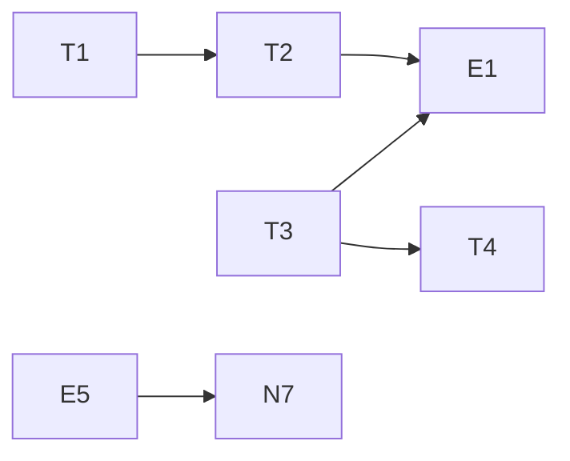
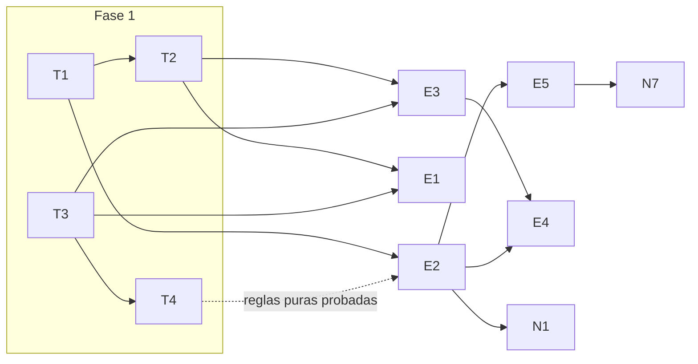
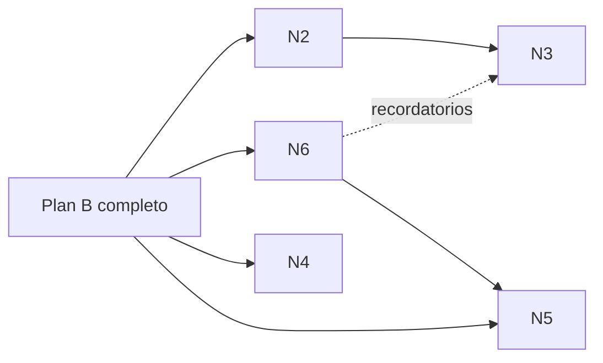

 # 04 · Planes de acción

> Tres planes que se pueden elegir por separado. Usan las propuestas del
> documento [03](03-propuestas-funcionalidades.md) con sus mismas estimaciones
> (supuestos en su cabecera). **No se ha implementado nada.** El trabajo empieza
> cuando se autorice un plan.
>
> Los planes son **acumulativos**: B contiene todo A, y C contiene todo B. Así se
> puede empezar con uno y ampliar después sin rehacer nada.
>
> Ritmo de referencia para los plazos: **10 h/semana** (equipo de una persona a
> tiempo parcial). Con 20 h/semana, dividir los plazos entre dos.

---

## Resumen

| | Plan A · Conservador | Plan B · Equilibrado | Plan C · Ambicioso |
|---|---|---|---|
| Propuestas | T1, T2, T3, T4, E1, E5, N7 | A + E2, E3, E4, N1 | B + N6, N2, N3, N4, N5, T5 |
| Esfuerzo | **39-60 h** | **89-134 h** | **148-221 h** |
| Plazo (10 h/sem) | 4-6 semanas | 9-13 semanas | 15-22 semanas |
| Hallazgos de severidad alta corregidos | 5 de 6 | 6 de 6 | 6 de 6 |
| Tecnología nueva | Vitest | Vitest | Vitest, `pg_cron`, 2ª Edge Function |
| Cambios de arquitectura | Ninguno | Modelo de estados de cita ampliado | Tareas programadas y notificaciones por eventos |
| Riesgo técnico | Bajo | Medio | Medio-alto |

Hallazgos de severidad alta (doc 01 §13): H-S1, H-S2, H-R1, H-U1, H-U2, H-M1.
El plan A deja abierto **H-R1** (horarios rechazados inutilizados) y también los
de severidad media del núcleo de la cita: **H-R2, H-R3, H-R4** (historial que se
borra, reservas sin límites, reagendar que no reagenda).

---

## Plan A · Conservador

**Objetivo.** Cerrar los riesgos de seguridad y robustez y añadir mejoras
visibles baratas, reutilizando al máximo la guía, **sin tocar el modelo de citas**.

### Funcionalidades y orden

| # | Propuesta | Horas | Por qué en este orden |
|---|---|---|---|
| 1 | **T1** Versionar el esquema | 3-5 | Toda migración posterior parte de esta línea base |
| 2 | **T2** Endurecimiento de seguridad | 8-12 | Cierra H-S1 y H-S2 cuanto antes |
| 3 | **T3** Sesión y errores robustos | 8-12 | Deja estable la base de todas las pantallas |
| 4 | **T4** Pruebas y tipos generados | 6-10 | Red de seguridad antes de tocar pantallas |
| 5 | **E1** Ajustes de cuenta | 6-9 | Requiere `actualizarNombre` (T3) y los grants (T2) |
| 6 | **E5** Navegación por URL | 4-6 | Crea el detalle de cita que usa N7 |
| 7 | **N7** Cómo llegar a tu cita | 4-6 | Solo composición de piezas existentes |
| | **Total** | **39-60 h** | |

### Dependencias

### Beneficios esperados
- Sin vías conocidas para saltarse la aprobación del admin ni para tomar la cuenta del administrador.
- Los fallos de red ya no expulsan al login ni muestran listas vacías engañosas; mensajes en español.
- La base se puede reconstruir y revisar; hay pruebas automáticas de lógica y de permisos.
- Tres mejoras visibles: Ajustes funcional, "atrás" del móvil, cómo llegar a la sede.

### Riesgos técnicos
- Romper pantallas al restringir la lectura de `usuarios` y `reportes` (T2). *Mitigación:* `permisos.sql` + prueba con `npm run dev:all` en los tres roles.
- El trigger de perfil, si falla, impide registrarse (T3). *Mitigación:* `on conflict do nothing`, sin validaciones que puedan fallar.
- El personal pierde la autorrecuperación de contraseña. *Mitigación:* procedimiento manual documentado.

### Cambios de arquitectura
Ninguno estructural. El perfil pasa a crearlo la base (trigger) en lugar del
cliente, y se añade Vitest como dependencia de desarrollo.

### Qué queda pendiente
El ciclo de la cita sigue con sus defectos (H-R1 a H-R4, H-R7), las novedades
siguen sin datos estructurados y el admin no tiene estadísticas.

---

## Plan B · Equilibrado  ⭐ recomendado

**Objetivo.** Plan A más completar el **núcleo del producto** (la cita) y
convertir el flujo de novedades en información útil para pacientes y admin.
Todo con la arquitectura actual: React + funciones de Postgres + Realtime.

### Funcionalidades y orden

| Fase | # | Propuesta | Horas | Notas |
|---|---|---|---|---|
| **1. Cimientos** | 1 | T1 Versionar el esquema | 3-5 | |
| | 2 | T2 Endurecimiento de seguridad | 8-12 | |
| | 3 | T3 Sesión y errores robustos | 8-12 | |
| | 4 | T4 Pruebas y tipos generados | 6-10 | |
| **2. Núcleo** | 5 | **E2 Ciclo de vida de la cita** | 16-24 | Requiere decisiones de producto (ver abajo) |
| **3. Mejoras visibles** | 6 | E1 Ajustes de cuenta | 6-9 | |
| | 7 | E5 Navegación por URL | 4-6 | El detalle de cita muestra los estados nuevos de E2 |
| | 8 | N7 Cómo llegar | 4-6 | |
| **4. Novedades** | 9 | E3 Bandeja de novedades 2.0 | 10-14 | |
| | 10 | E4 Alertas dirigidas con hora estimada | 8-12 | Usa `cancelada_por` de E2 y los datos de E3 |
| **5. Supervisión** | 11 | **N1 Estadísticas del admin** | 16-24 | Con E2 ya hecho, incluye inasistencia y tiempo de respuesta |
| | | **Total** | **89-134 h** | |

Hitos con valor por sí solos: al acabar la **fase 1** el producto es seguro y
estable; al acabar la **fase 3** equivale al plan A más una cita completa; las
fases 4 y 5 son independientes entre sí y se pueden intercambiar.

### Dependencias

### Beneficios esperados
- Todo lo del plan A.
- **La cita funciona como un proceso completo**: historial fiel, horarios que se
  liberan al cancelar o rechazar, reprogramación real y atómica, límites de
  reserva y cierre (atendida / no asistió).
- **Las novedades se vuelven accionables**: el paciente ve la hora estimada de
  atención solo si le afecta y el admin puede cancelar en bloque ante una ausencia.
- **El admin gestiona con datos**: ocupación por especialidad y sede, demanda por
  hora, inasistencia, tiempos de respuesta.
- Aprovecha las piezas más valiosas de la guía (contexto de sesión, ajustes,
  bandeja, gráficos y estadísticas) sin añadir infraestructura.

### Riesgos técnicos
- **E2 cambia la semántica de `cancelar_cita`/`responder_cita`.** *Mitigación:*
  desplegar la migración y el frontend juntos; pruebas SQL de cada transición;
  migrar las 2 citas `rechazada` existentes.
- **Concurrencia en reprogramar/tomar.** *Mitigación:* índice único parcial + una transacción por operación + prueba de llamadas simultáneas.
- **Policies con funciones en la lectura de novedades (E4)** pueden encarecer las consultas. *Mitigación:* funciones `stable` e índices `(medico_id, fecha_afectada)`.
- **Estadísticas engañosas con pocos datos.** *Mitigación:* sembrar un histórico de demostración realista y cruzar cada cifra con una consulta de control.

### Cambios de arquitectura
- El **modelo de estados de la cita** se amplía (`atendida`, `no_asistio`, uso real
  de `cancelada`) y el **historial se conserva** con un índice único parcial en lugar
  de reutilizar la fila.
- `reportes` pasa a tener datos estructurados (`tipo`, `minutos_retraso`, `fecha_afectada`, `comentario_admin`, `origen`).
- La lectura de novedades pasa a ser **por rol** (RLS), complementada con recarga periódica.
- Sin servicios nuevos: todo sigue en Postgres + PostgREST + Realtime.

### Decisiones de producto necesarias antes de la fase 2
1. Límite de citas activas por paciente (propuesta: 1 por especialidad, 3 en total).
2. Plazo mínimo para cancelar (propuesta: 2 h antes).
3. ¿El motivo de rechazo de una novedad es obligatorio u opcional?
4. ¿Quién puede cerrar una cita: solo el médico o también el admin?
5. ¿Los médicos ven sus propias estadísticas o solo el admin?

---

## Plan C · Ambicioso

**Objetivo.** Plan B más **automatización y autonomía operativa**: la agenda se
mantiene sola, los usuarios reciben avisos persistentes, los pacientes no pierden
huecos y el admin gestiona personal y catálogo sin tocar SQL.

### Funcionalidades y orden

| Fase | # | Propuesta | Horas | Notas |
|---|---|---|---|---|
| 1-5 | — | **Todo el plan B** | 89-134 | T5 (3-5 h) se suma a la fase 1, junto a T4 |
| **6. Comunicación** | 12 | N6 Centro de notificaciones | 10-14 | Base para N3 y N5; puede reemplazar la alerta de E4 por notificaciones persistentes |
| **7. Agenda** | 13 | N2 Disponibilidad por médico | 12-18 | Usa el índice único de E2 |
| | 14 | N3 Automatizaciones programadas | 10-16 | Activa `pg_cron` |
| **8. Paciente** | 15 | N5 Lista de espera | 10-14 | Usa E2 + N6 |
| **9. Operación** | 16 | N4 Alta de médicos y catálogo | 14-20 | 2ª Edge Function con `service_role` |
| | | T5 Limpieza | 3-5 | (en la fase 1) |
| | | **Total** | **148-221 h** | |

### Dependencias

### Beneficios esperados
- Todo lo del plan B.
- **Agenda rodante sin intervención**: horarios según la plantilla de cada médico,
  solicitudes caducadas que se liberan solas, novedades archivadas automáticamente.
- **Avisos que no se pierden**: campana con historial para los tres roles.
- **Lista de espera**: aprovecha cancelaciones que hoy se desperdician (diferenciador claro).
- **Producto operable por un administrador real**: altas de médicos, sedes y
  especialidades desde la interfaz; restablecimiento de contraseñas del personal.

### Riesgos técnicos
- **`pg_cron` ejecuta como `postgres` y salta RLS.** *Mitigación:* funciones sin `execute` para la API, pruebas en `permisos.sql`, supervisión de `cron.job_run_details`.
- **Zona horaria de `pg_cron` (UTC).** *Mitigación:* programar en UTC con comentarios en hora de Bogotá y pruebas de borde a medianoche.
- **Edge Function con `service_role` que crea usuarios.** Si falla la comprobación de rol, cualquiera podría crear personal. *Mitigación:* `verify_jwt`, comprobación explícita del rol admin, pruebas negativas, compensación ante altas a medias.
- **Más triggers = más acoplamiento** (notificaciones, lista de espera). *Mitigación:* triggers pequeños e idempotentes, con cada regla en una función con nombre propio y probada.
- **Alcance**: con 150-220 h el riesgo de no terminar es real. *Mitigación:* las fases 6-9 son independientes; se puede parar tras cualquiera.

### Cambios de arquitectura
- **Procesamiento en segundo plano** dentro de la base (`pg_cron`): se activa una extensión.
- **Modelo orientado a eventos**: triggers que generan notificaciones y avisos de lista de espera.
- **Segunda Edge Function con privilegios de administración** de Auth.
- Nuevas tablas: `notificaciones`, `disponibilidad`, `bloqueos`, `lista_espera` (y opcionalmente `festivos`, `configuracion`).

---

## Recomendación: Plan B

**Recomiendo el Plan B (Equilibrado)**, ejecutado en el orden de fases indicado.

1. **Corrige todos los hallazgos de severidad alta** y los del núcleo de la cita
   (H-R1 a H-R4). El plan A los deja abiertos, y son los que más se notan al usar
   la app: horarios que desaparecen al rechazar y un botón "Reagendar" que no
   reagenda.
2. **Invierte donde el producto es más débil.** La auditoría muestra que la
   interfaz es correcta y que las carencias están en las reglas de negocio y en
   la supervisión. E2 y N1 atacan justo eso.
3. **Es el que mejor aprovecha la guía**: trae casi todas las piezas A/B con valor
   real (contexto de sesión, errores, ajustes, gráficos, estadísticas, bandeja)
   y ninguna del dominio de buses.
4. **No añade infraestructura.** Todo cabe en lo que ya existe (Postgres, Realtime,
   la Edge Function actual); la única dependencia nueva es Vitest. El plan C
   introduce `pg_cron`, una Edge Function con privilegios y un modelo por eventos,
   que solo compensan si SaludApp va a tener usuarios reales.
5. **Tiene salidas intermedias.** Al terminar la fase 1 ya se ha resuelto lo
   urgente; al terminar la fase 3 se tiene el plan A más una cita completa. Si
   el plazo se acorta, se puede parar ahí sin dejar nada a medias.

**Cuándo elegir otro plan:**
- **Plan A** si el objetivo es solo entregar o defender el ejercicio de clase
  en pocas semanas: arregla lo grave y suma tres mejoras visibles.
- **Plan C** si SaludApp va a operar con pacientes reales y hay más de 150 h
  disponibles. En ese caso, antes de N4 conviene sustituir la recuperación por
  pregunta por la del correo y hacer una revisión legal del tratamiento de datos de salud.

**Independientemente del plan elegido**, si la demo está publicada o se va a
compartir, **T2 (puntos 1 y 5) debería hacerse primero**: hoy cualquiera que lea
el README puede apoderarse de la cuenta de administrador.

---

## Información pendiente para confirmar el plan

| Pregunta | Qué cambia según la respuesta |
|---|---|
| ¿Demo de clase o despliegue con pacientes reales? | Elección de plan; si hay que sustituir la recuperación por pregunta; si hace falta revisión legal |
| ¿Hay acceso al código de Buses Metro? | Sin acceso, +20-40 % en T3, T4, E1, N1 y E3 |
| Plazo y dedicación semanal | Plan viable |
| ¿Supabase Auth exige confirmación de correo? | Prioridad del punto 3 de T3 |
| Las 5 decisiones de producto del plan B | Alcance de E2, E3 y N1 |
| Hosting previsto | Configuración del *rewrite* SPA (E5) y de la restricción de la clave de Maps |

## Respuestas recibidas (23-nov-2026)

| Pregunta | Respuesta | Consecuencia |
|---|---|---|
| ¿Demo o producción? | Demo de clase, sin complejidad | Los planes B y C quedan fuera de alcance |
| ¿Acceso a Buses Metro? | Sí | Solo se encontró `proyectobuses-rediseno-login-roles.zip` (9-sep-2026), **anterior** a la guía: tiene `schema.sql`/`policies.sql`, pero no `mensajesError`, `VentanaAjustes`, `ProblemaPerfil` ni Vitest. Esos módulos se escriben a partir de la guía (son pequeños; impacto bajo) |
| Plazo | **Miércoles 25-nov-2026** (2 días) | Ni el plan A (39-60 h) cabe completo → plan exprés |
| Decisiones de producto | Aceptadas las propuestas | 1 cita activa por especialidad y 3 en total; cancelar hasta 2 h antes; motivo de rechazo opcional; solo el médico cierra citas; estadísticas solo para el admin |

## Plan exprés para el miércoles (recomendado para la demo)

Un recorte del plan A más la parte imprescindible de E2. El orden importa: si el
tiempo se acaba, lo hecho hasta ese punto ya está terminado y se puede usar.

| # | Bloque | Sale de | Qué incluye | Horas* |
|---|---|---|---|---|
| 0 | Migraciones guardadas | T1 (mínimo) | Cada cambio de la base se guarda en `supabase/migraciones/` | incluido |
| 1 | **Seguridad mínima** | T2 (puntos 1, 2 y 5) | Novedad obligatoriamente `pendiente` al crearla; revocar `execute` a `anon`; recuperación solo para pacientes; quitar la respuesta de seguridad del README | 1-2 |
| 2 | **Errores y sesión** | T3 (reducido) | `mensajesError` en español; perfil con `maybeSingle` + pantalla "sin conexión / sin perfil"; arreglar el "Un momento…" infinito; `AvisoError` en las cargas | 3-4 |
| 3 | **Cita bien hecha** | E2 (reducido) | Rechazar/cancelar conserva el historial y reabre el horario; índice único; "Reagendar" real y atómico; límites de reserva y plazo de cancelación; confirmación antes de cancelar | 4-6 |
| 4 | **Ajustes de cuenta** | E1 | La tuerca abre la ventana para cambiar nombre, contraseña y pregunta de seguridad | 3-5 |
| 5 | *Si da tiempo:* **Cómo llegar** | N7 | Distancia y botón "Abrir en Google Maps" en la próxima cita | 2-3 |
| | **Total** | | | **13-20** |

\* Horas estimadas para una persona. Si la implementación la hace Claude Code,
el cuello de botella es la **prueba manual** con `npm run dev:all` en los tres
roles: conviene terminar el martes y dejar el miércoles para ensayar la demo.

**Fuera del plan exprés:** pruebas automatizadas (T4), navegación por URL (E5),
novedades 2.0 (E3/E4), estadísticas (N1) y todo el plan C.

**Riesgo principal:** los cambios de la base se aplican sobre el proyecto
Supabase de la demo (`khyfckehcvpnswdjyshv`). Cada migración es pequeña,
reversible y queda guardada en el repositorio.

## Siguiente paso

Autorizar el plan exprés (u otro alcance) y la forma de aplicar las migraciones.

## Estado de implementación del plan exprés (23-nov-2026)

| Bloque | Código | Base de datos |
|---|---|---|
| 1 · Seguridad mínima | — | `supabase/migraciones/2026-11-23_1_seguridad_minima.sql` (pendiente de ejecutar a mano) |
| 2 · Errores y sesión | ✅ `mensajesError`, `useAuth`/`AuthContext`, `ProblemaPerfil`, `AvisoError`, login y las tres páginas | `…_2_perfil_por_trigger.sql` (pendiente) |
| 3 · Cita bien hecha | ✅ cancelar con confirmación y límite de 2 h, reprogramar, historial, generación de horarios | `…_3_ciclo_de_cita.sql` (pendiente) |
| 4 · Ajustes de cuenta | ✅ `VentanaAjustes` conectada al botón ⚙️ | `…_4_ajustes_de_cuenta.sql` (pendiente) |
| 5 · Cómo llegar | ✅ en "Tu próxima cita" y en las citas activas | — |

Verificación: `tsc` sin errores, `oxlint` sin errores (7 avisos, antes 8), `vite build` correcto.
Falta la prueba manual con los tres roles después de ejecutar las migraciones.

## Avance del plan de acción (24-nov-2026)

| Parte | Propuesta | Código | Migración | Verificación |
|---|---|---|---|---|
| 1 · Novedades 2.0 | E3 | ✅ | `2026-11-24_1` ✅ aplicada | Prueba de punta a punta: 18/18 + 1 fallo de regla corregido en `2026-11-24_4` |
| 2 · Alertas dirigidas | E4 | ✅ | `2026-11-24_2` ✅ aplicada | Incluida en la prueba de punta a punta |
| 3 · Cierre de cita | E2 (resto) | ✅ | `2026-11-24_3` ✅ aplicada | Incluida en la prueba de punta a punta |
| 4 · Estadísticas | N1 | ✅ | `2026-11-24_4` y `_5` ✅ aplicadas | Función probada como admin y como paciente; regla de minutos corregida |
| 5 · Navegación por URL | E5 | ✅ (+ detalle de cita con mapa) | No necesita | tsc, lint y build; falta prueba en navegador |
| 6 · Pruebas y esquema | T4 / T1 | ✅ Vitest: 31 pruebas en 6 archivos · `schema.sql` + `policies.sql` + exportador | No necesita | `npm test`, `tsc -b`, lint y build. Pendiente: tipos generados del cliente (después de la demo) |
